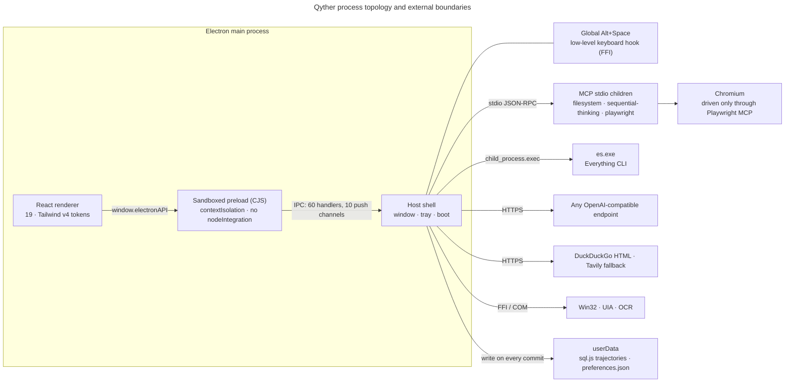
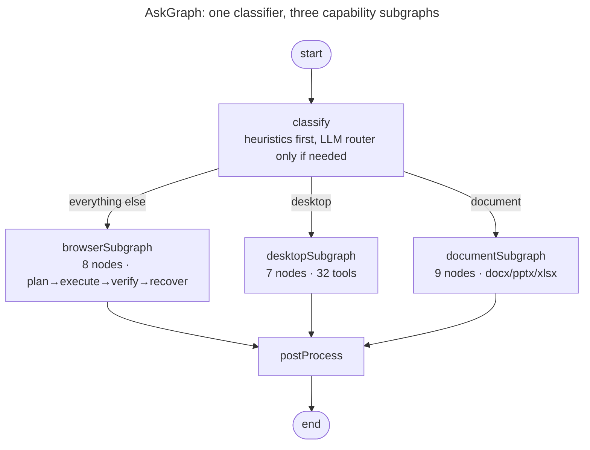

<p align="center">
  
  
</p>

<p align="center">
  <a href="https://github.com/Launchero/Qyther/actions/workflows/ci.yml"></a>
  
  
  <a href="LICENSE"></a>
</p>

Qyther is a Windows command palette — press `Alt+Space` anywhere, type, act. It started as a launcher and grew into something more interesting: a local host for an agent that can search your files, browse the web, write office documents, and **move the mouse and press keys on your actual desktop**, with a human approval gate in front of every action that can break something.

This repository is the whole system: the Electron host, the LangGraph agent runtime, 32 native Windows automation tools, and the design system the UI is built from. It is a work in progress, and the [known gaps](#what-qyther-does-not-do) section is as long as the feature list on purpose.

> **Status**: source-available under a commercial licence. No binaries are published yet — [build it yourself](#run-it).

---

## What it looks like

The captures below are real frames from the running app, taken over the dev build's CDP endpoint by [`scripts/capture-ui.mjs`](scripts/capture-ui.mjs). Nothing is composited or mocked, and the harness refuses to write any frame whose file results fall outside this repository.

<p align="center">
  
  
</p>
<p align="center"><sub>Expanded mode (800×600): the same window that is a 100px strip in compact mode. Quick actions, live file results, and the theme toggle in the footer.</sub></p>

| | |
|---|---|
|  |  |
| <sub>**Compact mode** — the `Alt+Space` strip. Everything is keyboard-first.</sub> | <sub>**Shortcut reference** — the in-app help sheet, opened from the footer.</sub> |
|  |  |
| <sub>**File results** — Everything's `es.exe` index, queried as you type.</sub> | <sub>**Light theme** — one token system drives both; the theme toggle is in the footer.</sub> |

Ask mode is deliberately not pictured: with no `API_KEY` set the app never reaches its welcome state, and a screenshot of a spinner would be the honest one. The transcript, citation brackets, thinking steps and generative-UI cards are all live code — described below, and capturable by anyone who points the app at their own model endpoint.

---

## The two-mode idea

One frameless, transparent, always-on-top window lives at 15% from the top of the work area and changes shape instead of opening new windows:

- **Compact** (800×100) — a launcher strip. Type, arrow through results, `Enter` to act.
- **Expanded** (800×600) — a workspace. Streaming chat, agent progress, generative-UI result cards.

`Alt+Shift+M` toggles the shape; `Alt+Shift+T` toggles the theme; `Escape` hides the window rather than closing the app. The mode is persisted, so a relaunch returns the shape you left.

Two orthogonal states drive everything, and conflating them is the classic mistake in this codebase: `windowMode` (`compact | expanded | custom`) is geometry, owned by the main process; `searchMode` (`file | ai`) is the tab, owned by the renderer. They intersect in exactly one conditional.

---

## Architecture



Ask mode is a compiled LangGraph. The classifier picks one of three subgraphs, all three fan into a post-process node, and the answer streams back token-by-token:



Four compiled graphs, 29 nodes total. Three diagrams with named edges and a source-of-truth table live in [`docs/diagrams/`](docs/diagrams); the deep reference — boot order, the IPC contract, streaming rules, persistence, and the traps — is [`docs/architecture.md`](docs/architecture.md).

### The part worth reading about

**A verifier, not just a generator.** After the desktop agent acts, the system checks its own work: it re-reads the UIA element it claims to have clicked, compares a screenshot and pixel diff, and runs OCR as a third signal (weighted 0.4 window / 0.4 pixel / 0.2 OCR). Below 0.3 it hard-rejects and hands the failure to a recovery ladder — retry, alternative, replan, skip, abort — which aborts after three attempts. Most agent demos skip this layer. It is the reason this one is slow on some tasks and honest on others.

**Human-in-the-loop is a type, not a policy suggestion.** Every desktop tool declares a danger level in a `Record<ToolName, DangerLevel>`, so the TypeScript compiler refuses a new tool that has no classification. 29 are safe, 2 are reviewable (`drag`, `execute_command`), 1 is dangerous (`close_window`). Anything not `safe` raises a LangGraph `interrupt()` and waits for a click in the UI. A denial is written back into the conversation as both a tool result and a human message instructing the model not to retry — because models do retry.

**The graph streams, the UI doesn't poll.** Tokens travel over `chat:stream-chunk`, agent attribution over `chat:agent-change`, reasoning steps over `chat:thinking-step`, with one checkpoint thread per turn. That coupling is also the codebase's sharpest edge: a new node missing its entry in two whitelists streams nothing at all, silently. It is documented in the contract file for exactly that reason.

---

## Capabilities

| Surface | What it does | Notes |
|---|---|---|
| **Files** | Instant local file search | Windows `es.exe` (Everything) index, auto-downloaded on first run; falls back to an unavailable-state message |
| **Ask** | Streaming chat with citations, thinking steps, generative-UI cards | Tables, comparisons, charts, form previews rendered from structured model output |
| **Browser** | Multi-step web research and automation | Plan → execute → verify → recover over Playwright MCP; on-disk `SKILL.md` prompt material; trajectory memory |
| **Desktop** | Real GUI automation on Windows | 32 tools over Win32 FFI, UIA COM and OCR; per-tool danger policy with HITL interrupts |
| **Documents** | Writes `.docx`, `.pptx`, `.xlsx` | `docx` / `pptxgenjs` / `xlsx`; output sandboxed to `~/Documents` with sanitised names; written bytes are re-parsed to verify |
| **MCP** | Client for external tool servers | Servers come from `mcp-config.json`; tools are routed to intents by name prefix |
| **Memory** | Learns across runs | `sql.js` trajectory, step and failure tables under `userData`; flushed to disk on every write |

Counts are re-derived from source, not copied from a document:

```bash
grep -cE "^export function create[A-Za-z]+Tool" src/main/services/desktop/desktop-tools.ts   # 32 desktop tools
grep -rc "\.addNode(" src/main/services/{langgraph/research-agent,browser/browser-subgraph,desktop/desktop-subgraph,document/document-subgraph}.ts   # 5 + 8 + 7 + 9 = 29 nodes
grep -rhoE "ipcMain\.handle\(\s*['\"][^'\"]+" src/main | sed -E "s/.*\(\s*['\"]//" | sort -u | wc -l   # 60 IPC channels
```

---

## Security model, stated plainly

The renderer is sandboxed: `app.enableSandbox()`, `contextIsolation: true`, `nodeIntegration: false`, `sandbox: true`, one preload bridge, `setWindowOpenHandler` denied, and `will-navigate` restricted to the dev origin and `file:`. DevTools and the CDP port exist only under `NODE_ENV=development`. There is no telemetry, no analytics SDK and no account system; the only outbound calls are the model endpoint you configure, the web-search endpoints, and the `es.exe` release download.

That is the good part. Here is what is not finished, because a security section that only lists defences is not a security section:

- **`command:execute` is guarded in the wrong layer.** Its blocklist lives in the preload script, which is renderer-reachable, so a direct `ipcRenderer.invoke` bypasses it; the main-process handler runs `promisify(exec)` with no second check.
- **`file:revealInFolder` has no validation anywhere.**
- **Validation is asymmetric by channel** — some check in main, some only in preload. There are no shared validators; each handler validates inline.
- **`execute_command` runs arbitrary text through PowerShell.** Its only guard is the reviewable HITL gate, so approving it is approving a shell.
- **The agent's reach is your reach.** Everything the desktop and browser agents do happens as your Windows user, with your file access. MCP servers are child processes you configure — the filesystem server's allowed directories are yours to keep narrow.

If you find something beyond this list, see [SECURITY.md](SECURITY.md).

---

## Run it

**Requirements**

- Windows 10/11 x64. Packaging is NSIS-only; there are no macOS or Linux build scripts.
- Node 22+ (developed on 24) and npm.
- A C++ toolchain (`Desktop development with C++` workload) for `node-winautomation`. Without it `npm install` fails while building that one native addon; the app still runs, and UIA-based desktop tools do not.
- Any OpenAI-compatible endpoint and a key, for Ask mode. File search, quick actions and the launcher work without one.

```bash
npm install          # .npmrc carries one legacy-peer-deps line; see the note below
npm run dev          # electron-vite dev — the only runtime harness in this repo
```

Then press `Alt+Space`. If the palette does not appear, look for the Electron process; the window is `skipTaskbar` by design.

Environment, in `.env` (see [`.env.example`](.env.example)):

| Variable | Purpose |
|---|---|
| `API_KEY` · `BASE_URL` · `MODEL` | Model credentials and endpoint. Read at module load, so they must be set before first import. |
| `FAST_MODEL` | Small model for classification and rewriting. |
| `TAVILY_API_KEY` | Optional search provider; DuckDuckGo HTML is the default. |
| `LOG_LEVEL`, `LOG_DESKTOP`, `LOG_BROWSER`, … | Per-subsystem logging. A subsystem not registered in `SUBSYSTEM_ENV_VARS` inherits the global level, which is `error` in production. |

Package an installer with `npm run build:win` (unpacked dir: `npm run build:win:dir`).

> **About `.npmrc`.** The latest stable `electron-vite` declares a peer range of `vite ^5 || ^6 || ^7`, while this project builds on Vite 8 — which `vitest`, `@vitejs/plugin-react` and `vite-tsconfig-paths` all require. The tracked `.npmrc` sets `legacy-peer-deps=true` so `npm install` works on a fresh clone. Delete it once `electron-vite` accepts Vite 8.

---

## Keyboard reference

Navigation · arrows, `Home`/`End`, `PageUp`/`PageDown`, `Enter`, `1`–`9`, and `j`/`k` + `Ctrl+N`/`Ctrl+P` for Emacs-style movement outside the text field. `Ctrl+Shift+Enter` sends the selected file to Ask mode with it attached. `Shift+Tab` cycles modes. Global: `Alt+Space` toggle, `Alt+Shift+T` theme, `Alt+Shift+M` window size. AI mode: `Shift+Enter` newline, `Ctrl+Shift+B` browser mode, `Ctrl+Shift+X` stop session, `Ctrl+Shift+M` MCP servers. `Ctrl+/` opens the sheet in the screenshot above.

---

## Repository map

```
src/main/          Electron host: boot, window, tray, keyboard hook, preferences, logging
  ipc/             60 IPC handlers + the preload bridge (one contract, two trees)
  services/
    langgraph/     the AskGraph: nodes, state reducers, in-graph tools
    desktop/       32 Windows automation tools, danger policy, verifiers, recovery
    browser/       Playwright-MCP subgraph, skills, memory, session lifecycle
    document/      docx/pptx/xlsx generation and verification
    mcp/           MCP client and tool routing
    database/      sql.js persistence and migrations
src/preload/       the single contextBridge surface
src/renderer/      React palette shell, ask-mode UI, hooks, design tokens
scripts/           icon generation, FFI smoke test, UI capture harness
docs/              architecture reference, diagrams, studies
design-systems/    the token and component rules the UI obeys
```

### Every folder ships a work contract

This repo is organised as a DOX tree: a root [`AGENTS.md`](AGENTS.md) rail plus a binding [`AGENTS.md`](src/main/services/desktop/AGENTS.md) in each owned subtree, stating purpose, ownership, local contracts, work guidance and verification. The rules that actually cause silent breakage are written down there — that every IPC channel is four hand-synced sites with no codegen, that adding one desktop tool requires six coupled edits, that a new graph node missing two whitelists streams nothing, that a new logger subsystem needs a registry entry or its logs vanish in production. Read [`AGENTS.md`](AGENTS.md) before editing; the nearest document wins local detail.

---

## Development gates

```bash
npm run lint         # eslint; react-hooks/rules-of-hooks is an error
npm run typecheck    # tsc --noEmit
npm run test         # vitest run
npm run build        # electron-vite build
```

Current state, measured rather than asserted: typecheck passes with 0 errors; lint reports 0 errors and 81 warnings; the test run is green with 65 tests across 2 files — **and neither file imports production code**, so treat that green as weak evidence. The desktop subtree, both agent loops, the graph, the streaming contract and the database layer have no automated coverage. [Contributions that add real tests](CONTRIBUTING.md) are the most useful thing you can do here.

The UI captures are reproducible: start `npm run dev`, then `node scripts/capture-ui.mjs`.

---

## What Qyther does not do

- No macOS or Linux builds, no signed installers, no auto-updater, no published releases.
- No single-instance lock, and no blur-to-hide — the window hides on `Escape`, on close, or via `Alt+Space`.
- No vector store, embeddings or RAG index. "Internal knowledge" answers come from the model, and document loading is attachment-text-extraction, not retrieval.
- The document subtree's **read** path is not wired end-to-end: a read-classified task dead-ends, and writing the same file name twice overwrites (the collision counter is unreachable).
- Browser `SKILL.md` material is read from disk at runtime and is **not copied into the production bundle**, so a packaged build silently runs with zero skills.
- Chat history is in-memory only; trajectories and failures persist, conversations do not.
- The system tray can fail to appear when `build/icons/icon-256.png` has not been generated, because icon generation writes to a different path than the tray reads.
- There is no in-app API-key screen; the `ApiKeySetup` component exists but is not mounted. Configure `.env`.

---

## Contributing

Read [CONTRIBUTING.md](CONTRIBUTING.md) — it lists the sync rules that break silently and the greps that catch them. [SECURITY.md](SECURITY.md) covers reporting; [CHANGELOG.md](CHANGELOG.md) tracks versions under Keep a Changelog.

## License

Source-available under the [Qyther Commercial Software License](LICENSE). No part of this repository may be used commercially except as that licence permits. It is **not** MIT, and earlier revisions of this README said otherwise — that was wrong.

## Acknowledgements

Electron, React, the LangChain and LangGraph teams, shadcn/ui primitives, Radix, Tailwind v4, Phosphor icons, `koffi`, `node-winautomation`, `sql.js`, `docx`, `pptxgenjs`, `xlsx`, `mammoth`, `pdf-parse`, Playwright MCP, and voidtools' Everything.
