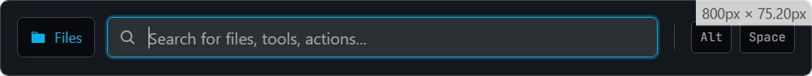
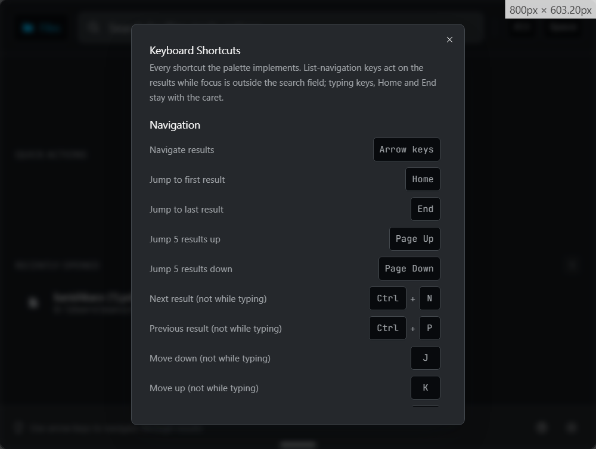
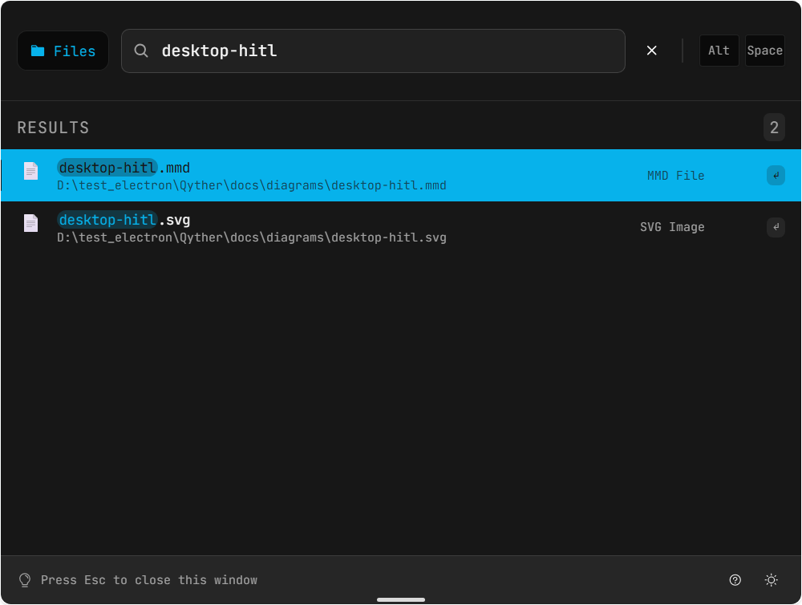
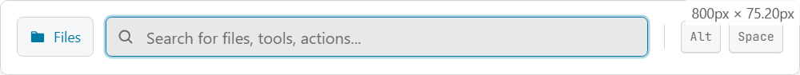
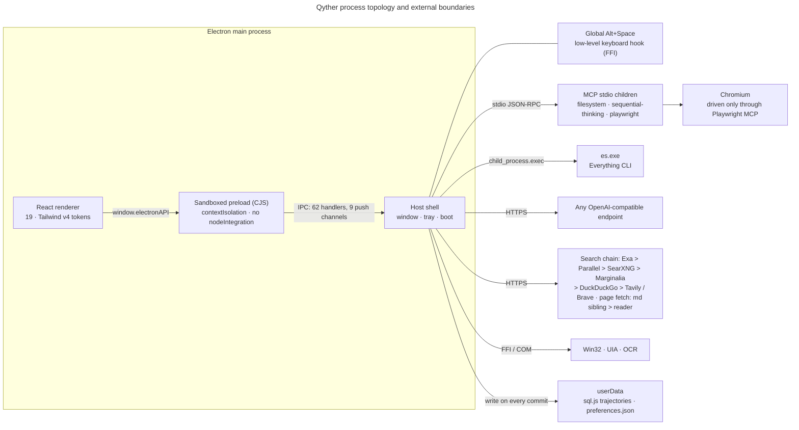
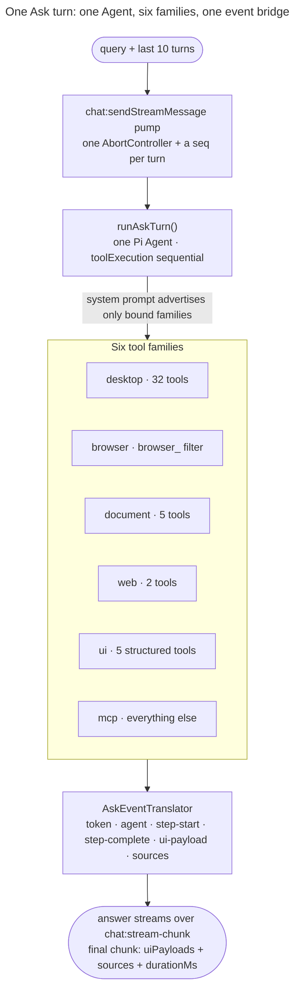

<p align="center">
  
  
</p>

<p align="center">
  <a href="https://github.com/Launchero/Qyther/actions/workflows/ci.yml"></a>
  
  
  <a href="LICENSE"></a>
</p>

Qyther is a Windows command palette — press `Alt+Space` anywhere, type, act. It started as a launcher and grew into something more interesting: a local host for an agent that can search your files, browse the web, write office documents, and **move the mouse and press keys on your actual desktop**, with no approval gate in front of any of it — every desktop tool runs without asking, by deliberate product decision.

This repository is the whole system: the Electron host, the Pi agent runtime, 32 native Windows automation tools, and the design system the UI is built from. It is a work in progress, and the [known gaps](#what-qyther-does-not-do) section is as long as the feature list on purpose.

> **Status**: source-available under a commercial licence. No binaries are published yet — [build it yourself](#run-it).

---

## What it looks like

The captures below are real frames from the running app, taken over the dev build's CDP endpoint by [`scripts/capture-ui.mjs`](scripts/capture-ui.mjs). Nothing is composited or mocked, and the harness refuses to write any frame whose file results fall outside this repository.

<p align="center">
  
  
</p>
<p align="center"><sub>Expanded mode (800×600): the same window that is a 72px strip in compact mode. Quick actions, live file results, and the theme toggle in the footer.</sub></p>

| | |
|---|---|
|  |  |
| <sub>**Compact mode** — the `Alt+Space` strip. Everything is keyboard-first.</sub> | <sub>**Shortcut reference** — the in-app help sheet, opened from the footer.</sub> |
|  |  |
| <sub>**File results** — Everything's `es.exe` index, queried as you type.</sub> | <sub>**Light theme** — one token system drives both; the theme toggle is in the footer.</sub> |

Ask mode is deliberately not pictured: with no `API_KEY` set the app never reaches its welcome state, and a screenshot of a spinner would be the honest one. The transcript, citation brackets, thinking steps and generative-UI cards are all live code — described below, and capturable by anyone who points the app at their own model endpoint.

---

## The two-mode idea

One frameless, transparent, always-on-top window lives at 15% from the top of the work area and changes shape instead of opening new windows:

- **Compact** (800×72) — a launcher strip. Type, arrow through results, `Enter` to act.
- **Expanded** (800×600) — a workspace. Streaming chat, agent progress, generative-UI result cards.

`Alt+Shift+M` toggles the shape; `Alt+Shift+T` toggles the theme; `Escape` hides the window rather than closing the app. The mode is persisted, so a relaunch returns the shape you left.

Two orthogonal states drive everything, and conflating them is the classic mistake in this codebase: `windowMode` (`compact | expanded | custom`) is geometry, owned by the main process; `searchMode` (`file | ai`) is the tab, owned by the renderer. They intersect in exactly one conditional.

---

## Architecture



Ask mode is one loop. `runAskTurn()` builds a fresh Pi `Agent` per turn over six tool families, the model routes by choosing a tool, and Pi's typed events are translated onto the three streaming channels — no classifier, no subgraphs, no checkpointer:



There is no graph, so there is nothing to count in nodes: the deleted `AskGraph`, its classifier, the browser and document subgraphs and the node registry were removed at the Pi cutover, and `grep -rn "NODE_AGENT_MAP\|\.addNode(" src --include=*.ts` matches comments only. Three diagrams with named edges and a source-of-truth table live in [`docs/diagrams/`](docs/diagrams); the deep reference — boot order, the IPC contract, streaming rules, persistence, and the traps — is [`docs/architecture.md`](docs/architecture.md).

### The part worth reading about

**Verification exists, and today the shipped loop does not use it.** `desktop/verifier.ts` is a real `GroundTruthVerifier`: it captures a baseline, diffs screenshots against a 0.01 threshold, records a window-title change, and flags a click whose pixel effect falls under 0.02. `PiDesktopAgent` in `pi/agent.ts` is the loop that would consult it — the initial-screenshot decision, the `details.verifies` opt-in, the failing verdict fed back with `agent.steer()`. But Ask mode never constructs that class: `runPiDesktopTask()` has zero production callers, so a shipped desktop turn runs the same 32 tools inside the one Ask Agent with **no** verifier in the loop. The 912-line natural-language postcondition checker and the retry/alternative/replan/skip/abort ladder that used to wrap them were deleted at the cutover and have no Pi equivalent. This is the largest honest gap in the product, and `docs/ask-mode-experience-research.md` §12.6 proposes the state-based oracle that would close it.

**No approval gate — tools run without asking.** There is no danger-level table any more, and no level that pauses for approval: there are no levels at all. Every one of the 32 tools runs without asking, by deliberate product decision. The only surviving opt-in is a `details.verifies` flag on a tool's own result, set by exactly one tool (`close_window`), and that flag is read by the unwired loop above.

**The loop streams, the UI doesn't poll.** Tokens travel over `chat:stream-chunk`, agent attribution over `chat:agent-change`, reasoning steps over `chat:thinking-step`, each push stamped with the turn's monotonic `seq` so the renderer can order events instead of guessing position. The coupling that used to make this dangerous — a new graph node missing its entry in two hand-maintained whitelists streamed nothing at all, silently — is gone with the graph: `AskEventTranslator` switches on Pi's discriminated `AgentEvent` union, so a new arm is a compile error, and the step label is read from the tool's own declaration through `FamilyIndex.displayLabelFor()` instead of a name→copy map on either side of the bridge. `families.test.ts` fails if such a map returns.

---

## Capabilities

| Surface | What it does | Notes |
|---|---|---|
| **Files** | Instant local file search | Windows `es.exe` (Everything) index, auto-downloaded on first run; falls back to an unavailable-state message |
| **Ask** | Streaming chat with citations, thinking steps, generative-UI cards | Tables, comparisons, charts, form previews rendered from structured model output |
| **Browser** | Multi-step web research and automation | Playwright MCP tools reached through the `browser_` prefix filter, inside the same turn as every other capability; on-disk `SKILL.md` material is matched against the query and appended to that turn's system prompt. The plan→execute→verify→recover subgraph and its trajectory store are deleted |
| **Desktop** | Real GUI automation on Windows | 32 tools over Win32 FFI, UIA COM and OCR, driven sequentially; no approval prompt — every tool runs as your user |
| **Documents** | Writes `.docx`, `.pptx`, `.xlsx` | `docx` / `pptxgenjs` / `xlsx`; output sandboxed to `~/Documents` with sanitised names; written bytes are re-parsed to verify |
| **MCP** | Client for external tool servers | Servers come from `mcp-config.json`; one shared connection, which the `browser` family takes by `browser_` prefix and the `mcp` family takes as everything else |
| **Memory** | Records every turn; does not learn from them yet | One trajectory row plus its per-tool steps land in `sql.js` under `userData` per completed Ask turn, flushed to disk on every write. **Nothing reads them back**, and the failure table still has zero writers — recording is not memory |

Counts are re-derived from source, not copied from a document:

```bash
npx vitest run src/main/services/pi/toolbox.test.ts   # 32 desktop tools, frozen by assertion
sed -n '/export const TOOL_FAMILIES/,/^\];/p' src/main/services/pi/families.ts | grep -c '"'   # 6 tool families
grep -rhoE "ipcMain\.handle\(\s*['\"][^'\"]+" src/main | sed -E "s/.*\(\s*['\"]//" | sort -u | wc -l   # 62 IPC channels
```

The desktop tool count has two re-derivations that agree: `awk '/^export function createPiDesktopToolbox/,/^}$/' src/main/services/pi/toolbox.ts | grep -c "Tool("` counts 32 construction sites, and `pi/toolbox.test.ts` asserts the same 32 names. What does **not** work is grepping `toolbox.ts` for `name:` — bare `name:` reports 27 and `name: "` reports 23, because several tools are built by factories that receive their name as an argument.

---

## Security model, stated plainly

The renderer is sandboxed: `app.enableSandbox()`, `contextIsolation: true`, `nodeIntegration: false`, `sandbox: true`, one preload bridge, `setWindowOpenHandler` denied, and `will-navigate` restricted to the dev origin and `file:`. DevTools and the CDP port exist only under `NODE_ENV=development`. There is no telemetry, no analytics SDK and no account system; the only outbound calls are the model endpoint you configure, the web-search endpoints, and the `es.exe` release download.

That is the good part. Here is what is not finished, because a security section that only lists defences is not a security section:

- **Validation is still asymmetric by channel.** Three guards now live in their own Electron-free modules and are called from main before the handler acts — `command-guard.ts` (`isCommandSafe`, gating `command:execute`), `file-guard.ts` (`isSafeSearchQuery`/`isUsablePath`, gating `file:search`, `file:open` and `file:revealInFolder`) and `api-config-guard.ts` (`checkBaseUrl`, gating `api-config:save` and `api-config:test`, which used to fetch any URL the renderer named with a key attached). `file-guard.test.ts` fails if main's pattern list drifts from preload's. Everything else still validates inline, or not at all.
- **The preload layer is renderer-reachable, so its checks are not a boundary.** A compromised renderer can call `ipcRenderer.invoke` directly and skip whatever preload enforces; that is why the guards above had to move into main. In development the remote-debugging port is open, so a DevTools `Runtime.evaluate` there is OS command execution until main checks.
- **`execute_command` runs arbitrary text through PowerShell.** It has a 30 s default timeout and a 10 MB buffer, but no allowlist and no confirmation prompt, so invoking it is invoking a shell.
- **The agent's reach is your reach.** Everything the desktop and browser tools do happens as your Windows user, with your file access. MCP servers are child processes you configure — the filesystem server's allowed directories are yours to keep narrow.

If you find something beyond this list, see [SECURITY.md](SECURITY.md).

---

## Run it

**Requirements**

- Windows 10/11 x64. Packaging is NSIS-only; there are no macOS or Linux build scripts.
- Node 22+ (developed on 24) and npm.
- A C++ toolchain (`Desktop development with C++` workload) for `node-winautomation`. Without it `npm install` fails while building that one native addon; the app still runs, and UIA-based desktop tools do not.
- Any OpenAI-compatible endpoint and a key, for Ask mode. File search, quick actions and the launcher work without one.

```bash
npm install          # .npmrc carries one legacy-peer-deps line; see the note below
npm run dev          # electron-vite dev — the only runtime harness in this repo
```

Then press `Alt+Space`. If the palette does not appear, look for the Electron process; the window is `skipTaskbar` by design.

Environment, in `.env` (see [`.env.example`](.env.example)):

| Variable | Purpose |
|---|---|
| `API_KEY` · `BASE_URL` · `MODEL` | Model credentials and endpoint. Read **at the point of use** (`src/main/services/pi/provider.ts`), so a value that appears after the first import is picked up — an earlier build captured `process.env` at module scope, which made Ask mode report "not configured" on a correctly configured machine. `pi/provider.test.ts` pins the timing. |
| `TAVILY_API_KEY`, `BRAVE_API_KEY`, `JINA_API_KEY` | Optional web-search providers and the remote page reader. Search needs none of them: two keyless search APIs are tried first, and `JINA_API_KEY` only raises rate limits on the fallback reader. |
| `LOG_LEVEL`, `LOG_DESKTOP`, `LOG_BROWSER`, … | Per-subsystem logging. A subsystem not registered in `SUBSYSTEM_ENV_VARS` inherits the global level, which is `error` in production. |

Package an installer with `npm run build:win` (unpacked dir: `npm run build:win:dir`).

> **About `.npmrc`.** The latest stable `electron-vite` declares a peer range of `vite ^5 || ^6 || ^7`, while this project builds on Vite 8 — which `vitest`, `@vitejs/plugin-react` and `vite-tsconfig-paths` all require. The tracked `.npmrc` sets `legacy-peer-deps=true` so `npm install` works on a fresh clone. Delete it once `electron-vite` accepts Vite 8.

---

## Keyboard reference

Navigation · arrows, `Home`/`End`, `PageUp`/`PageDown`, `Enter`, `1`–`9`, and `j`/`k` + `Ctrl+N`/`Ctrl+P` for Emacs-style movement outside the text field. `Ctrl+Shift+Enter` sends the selected file to Ask mode with it attached. `Shift+Tab` cycles modes. Global: `Alt+Space` toggle, `Alt+Shift+T` theme, `Alt+Shift+M` window size. AI mode: `Shift+Enter` newline, `Ctrl+Shift+B` browser mode, `Ctrl+Shift+X` stop session, `Ctrl+Shift+M` MCP servers. `Ctrl+/` opens the sheet in the screenshot above.

---

## Repository map

```
src/main/          Electron host: boot, window, tray, keyboard hook, preferences, logging
  ipc/             62 IPC handlers + the preload bridge (one contract, two trees)
  services/
    pi/            the Pi runtime: one Ask loop, six tool families, 32 desktop tools, provider, event bridge
    desktop/       the native substrate Pi drives: Win32 FFI, UIA COM, OCR, capture, pixel verifier
    browser/       the Playwright-MCP executor, on-disk skills, session lifecycle (no subgraph, no memory store)
    document/      docx/pptx/xlsx generation and verification
    web/           the search-provider chain and the URL→text fetch pipeline
    mcp/           MCP client; the one shared connection that the browser and mcp families filter
    database/      sql.js persistence and migrations
    langchain/     name only: the in-memory chat session store and the browser-session owner — the graph is deleted
src/shared/        types-only IPC boundary modules imported by main, preload and renderer
src/preload/       the single contextBridge surface
src/renderer/      React palette shell, ask-mode UI, hooks, design tokens
scripts/           icon generation, FFI smoke test, UI capture harness, the live-input harness
docs/              architecture reference, diagrams, studies
design-systems/    the token and component rules the UI obeys
```

### Every folder ships a work contract

This repo is organised as a DOX tree: a root [`AGENTS.md`](AGENTS.md) rail plus a binding [`AGENTS.md`](src/main/services/desktop/AGENTS.md) in each owned subtree, stating purpose, ownership, local contracts, work guidance and verification. The rules that actually cause silent breakage are written down there — that every IPC channel is four hand-synced sites with no codegen, that the 32 desktop tools are a frozen name list, that a tool name claimed by two families makes one of them unreachable and `buildFamilyIndex` throws for it, that a step label must travel from the tool's own declaration rather than a name→copy map on either side of the bridge, and that a new logger subsystem needs a registry entry or its logs vanish in production. Read [`AGENTS.md`](AGENTS.md) before editing; the nearest document wins local detail.

---

## Development gates

```bash
npm run lint         # eslint; react-hooks/rules-of-hooks is an error
npm run typecheck    # tsc --noEmit
npm run test         # vitest run
npm run build        # electron-vite build
```

Current state, measured on 2026-10-16: typecheck passes with 0 errors; lint reports 0 errors and 11 warnings, all pre-existing and all in `src/main/services/desktop/**`; the test run is green with 400 tests across 50 files, 48 of which import production code — but the IPC surface is still only partly covered (see CONTRIBUTING for the caveats). The 32 desktop tools, the tool-family index, the Pi provider's env-read timing, the `AgentEvent`→bridge translation, the cancellation path, the trajectory-record builder, the window singleton, the quit-time teardown policy and the database layer all have automated coverage now, and two files mount Ask-mode components. Still uncovered: the app shell (`App.tsx`, the palette, results list, settings dialog), the `will-quit` wiring in `main.ts` itself, the browser subtree's behaviour, and `PiDesktopAgent` — which nothing in the shipped Ask path constructs. `npm run harness:selftest` remains the only gate that exercises the real window with real input. [Contributions that add real tests](CONTRIBUTING.md) are the most useful thing you can do here.

The UI captures are reproducible: start `npm run dev`, then `node scripts/capture-ui.mjs`.

---

## What Qyther does not do

- No macOS or Linux builds, no signed installers, no auto-updater, no published releases.
- No single-instance lock, and no blur-to-hide — the window hides on `Escape`, on close, or via `Alt+Space`.
- No vector store, embeddings or RAG index. "Internal knowledge" answers come from the model, and document loading is attachment-text-extraction, not retrieval.
- Writing the same file name twice **overwrites**: `uniqueFilePath` (`src/main/services/document/document-executor.ts`) is meant to append a counter, but an unconditional `break` at the top of its loop returns the plain path every time, so the collision branch is unreachable. Read and modify are wired (`read_document` / `modify_document` over `src/main/utils/document-loader.ts`) — there is no classifier that could mis-route them, because the model picks the tool.
- Browser `SKILL.md` material is read from disk at runtime and is **not copied into the production bundle**, so a packaged build silently runs with zero skills.
- Chat history is in-memory only; trajectories and failures persist, conversations do not.
- The system tray can fail to appear when `build/icons/icon-256.png` has not been generated, because icon generation writes to a different path than the tray reads.
- There is no in-app API-key screen; the `ApiKeySetup` component exists but is not mounted. Configure `.env`.

---

## Contributing

Read [CONTRIBUTING.md](CONTRIBUTING.md) — it lists the sync rules that break silently and the greps that catch them. [SECURITY.md](SECURITY.md) covers reporting; [CHANGELOG.md](CHANGELOG.md) tracks versions under Keep a Changelog.

## License

Source-available under the [Qyther Commercial Software License](LICENSE). No part of this repository may be used commercially except as that licence permits. It is **not** MIT, and earlier revisions of this README said otherwise — that was wrong.

## Acknowledgements

Electron, React, the LangChain and LangGraph teams, shadcn/ui primitives, Radix, Tailwind v4, Phosphor icons, `koffi`, `node-winautomation`, `sql.js`, `docx`, `pptxgenjs`, `xlsx`, `mammoth`, `pdf-parse`, Playwright MCP, and voidtools' Everything.
