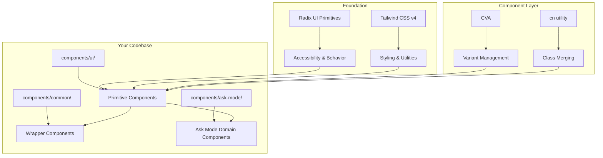
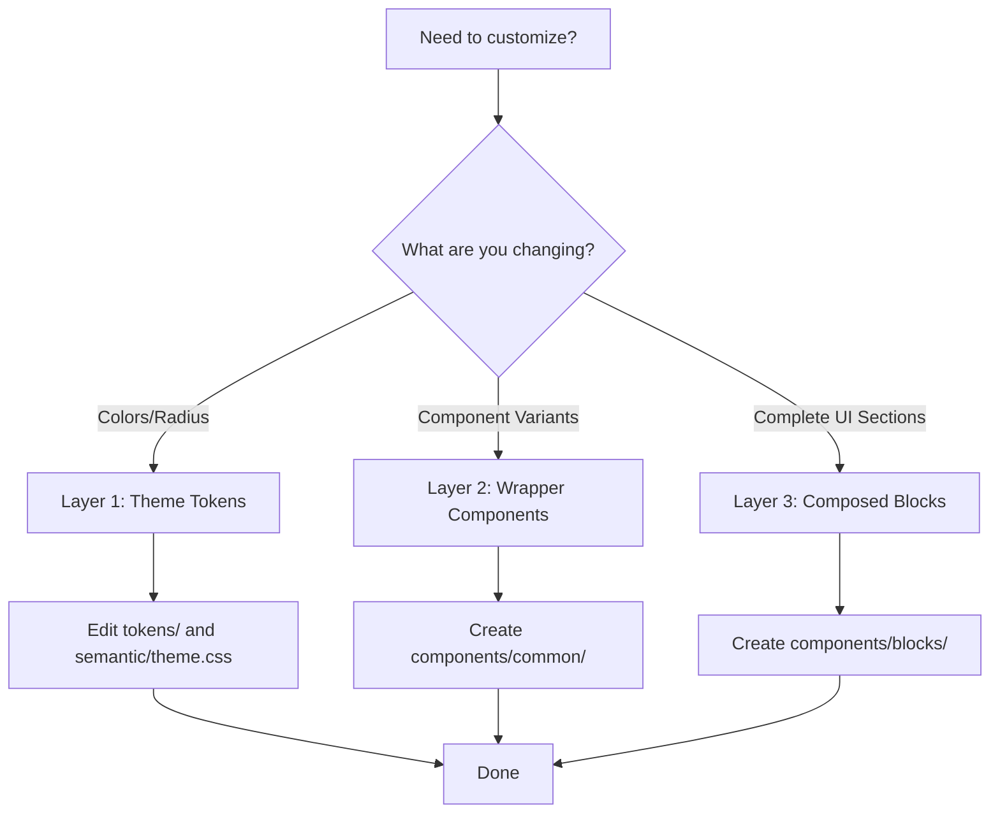

# shadcn/ui Design System Guide

**Last Updated**: April 2026  
**Version**: 1.0.0  
**Stack**: Electron 41 + React 19 + TypeScript 5.7 + Vite 6 + Tailwind CSS v4

## Table of Contents

1. [Core Principles](#core-principles)
2. [Architecture Overview](#architecture-overview)
3. [File Organization](#file-organization)
4. [Theming System](#theming-system)
5. [Component Patterns](#component-patterns)
6. [Best Practices](#best-practices)
7. [Customization Strategy](#customization-strategy)
8. [Component Registry](#component-registry)
9. [Accessibility](#accessibility)
10. [Performance](#performance)
11. [Update Strategy](#update-strategy)
12. [Integration Guide](#integration-guide)

---

## Core Principles

shadcn/ui is **not a component library** - it's how you build your component library.

### 1. Open Code

Components are source code, not dependencies. You own the code entirely.

- ✅ Full control over API and behavior
- ✅ No breaking changes from external updates
- ✅ Optimize per product requirements
- ✅ AI can read, understand, and improve

### 2. Composition

Every component shares a common, composable interface.

- Built on Radix UI primitives (headless, accessible)
- Styled with Tailwind CSS utilities
- Uses CVA (class-variance-authority) for variants
- `cn()` utility for intelligent class merging

### 3. Distribution

CLI-based component distribution with flat-file schema.

- Install components via `npx shadcn@latest add <component>`
- Components live in your codebase (`components/ui/`)
- Updates are opt-in via diff review

### 4. Beautiful Defaults

Carefully chosen default styles that work out-of-the-box.

- Clean, minimal aesthetic
- Consistent design language
- Easy to customize

### 5. AI-Ready

Open code structure enables AI assistance.

- LLMs can read and understand components
- AI can suggest improvements
- AI can generate new components following existing patterns

---

## Architecture Overview




### Technology Stack


| Technology                | Purpose                            | Version |
| ------------------------- | ---------------------------------- | ------- |
| **Radix UI**              | Headless primitives, accessibility | Latest  |
| **Tailwind CSS**          | Utility-first styling              | v4      |
| **TypeScript**            | Type safety                        | 5.7     |
| **CVA**                   | Component variant management       | ^0.7.1  |
| **clsx + tailwind-merge** | Class name composition             | Latest  |
| **React Hook Form**       | Form state management              | Latest  |
| **Zod**                   | Schema validation                  | ^4.3.6  |
| **TanStack Table**        | Data tables (optional)             | Latest  |


---

## File Organization

### Production-Ready Structure

```
src/renderer/
├── components/
│   ├── ui/                        # shadcn primitives (touch minimally)
│   │   ├── button.tsx             # Button with CVA variants
│   │   ├── card.tsx               # Card with Header, Content, Footer
│   │   ├── input.tsx              # Form input
│   │   ├── dialog.tsx             # Modal dialog
│   │   ├── badge.tsx              # Status badges
│   │   ├── dropdown-menu.tsx      # Contextual menu
│   │   ├── tooltip.tsx            # Hover tooltip
│   │   ├── avatar.tsx             # User avatar with fallback
│   │   └── ...                    # 16 available primitives
│   │
│   ├── common/                    # Wrapper components with custom logic
│   │   ├── ShortcutKeys.tsx       # Keyboard shortcut display
│   │   └── RegionSelector.tsx     # Region selection UI
│   │
│   ├── ask-mode/                  # Ask mode domain components
│   │   ├── ChatMessagesList.tsx   # Chat message display
│   │   ├── ThinkingSteps.tsx      # Agent thinking visualization
│   │   ├── GenerativeUI/          # Generative UI components
│   │   ├── Timeline/              # Timeline visualization
│   │   ├── Trust/                 # Trust and source verification
│   │   └── Transparency/          # Token/cost transparency
│   │
│   ├── CommandPalette.tsx         # Main command palette
│   ├── SearchBar.tsx              # Search input component
│   └── ...
│
├── styles/
│   ├── globals.css                # Orchestrator (imports all token files)
│   ├── tokens/                    # Base token layers (PRIMITIVES)
│   │   ├── colors.css             # Color primitives (OKLCH)
│   │   ├── spacing.css            # Spacing scale + container tokens
│   │   ├── typography.css         # Fonts, sizes, weights
│   │   ├── motion.css             # Durations, easing, animations
│   │   ├── radius.css             # Border radius scale
│   │   ├── shadow.css             # Elevation tokens
│   │   └── z-index.css            # Layering scale
│   └── semantic/
│       └── theme.css              # Semantic mappings + light/dark
│
└── lib/
    └── utils.ts                   # cn() utility, shared helpers
```

### Directory Responsibilities


| Directory            | Purpose            | Modification Rule                     |
| -------------------- | ------------------ | ------------------------------------- |
| `components/ui/`     | shadcn primitives  | Touch minimally, preserve for updates |
| `components/common/` | Wrapper components | Add custom logic, domain variants     |
| `components/ask-mode/` | Ask mode domain  | Chat, browser, generative UI components |
| `components/` root   | Top-level app components | Main UI elements              |
| `styles/tokens/`     | Base token primitives | Edit for design system tokens    |
| `styles/semantic/`   | Semantic mappings   | Light/dark theme definitions       |
| `styles/globals.css` | Token orchestrator  | Imports all token files            |
| `lib/utils.ts`       | Utilities          | Extend with project helpers          |


### What NEVER Goes in `components/ui/`

- ❌ Business logic
- ❌ API calls or data fetching
- ❌ Feature-specific components
- ❌ Components with hardcoded colors
- ❌ Components that know about your data structure

**Rule**: If a component can't be reused outside a specific feature, it doesn't belong in `components/ui/`.

---

## Theming System

### Token-Driven Architecture (MANDATORY for All UI Features)

This project uses a **layered token system** that MUST be used for every UI implementation. This ensures consistency, maintainability, and full dark mode support.

#### Token Layer Architecture

```
src/renderer/styles/
├── globals.css                    # Orchestrator (imports all token files + @custom-variant dark)
├── tokens/                        # BASE TOKEN LAYERS (Primitives) - use @theme
│   ├── colors.css               # Color primitives (OKLCH format)
│   ├── spacing.css              # Spacing scale + component dimensions
│   ├── typography.css           # Fonts, sizes, weights, line-heights
│   ├── motion.css               # Durations, easing curves, animations
│   ├── radius.css               # Border radius scale
│   ├── shadow.css               # Elevation shadows
│   └── z-index.css              # Layering scale
└── semantic/
    └── theme.css                # SEMANTIC LAYER (@layer theme + @theme inline mappings)
```

#### Why Tokens Are Mandatory

| Problem with Arbitrary Values | Token Solution |
| ----------------------------- | --------------- |
| `w-[800px]` breaks in dark mode | `--container-command-palette` = single source |
| `h-[44px]` inconsistent across components | `--container-input-height` = reusable |
| Hardcoded OKLCH colors not themeable | `--color-file-typescript` = semantic mapping |
| Cannot easily change component sizes globally | Edit one token, all components update |
| Hard to maintain consistency | Tokens enforce design system |

#### Usage Rules (STRICTLY ENFORCED)

**NEVER use these patterns**:
```tsx
// ❌ FORBIDDEN - Arbitrary pixel values
className="w-[800px]"
className="h-[44px]"
className="rounded-[10px]"
className="px-[12px]"

// ❌ FORBIDDEN - Hardcoded OKLCH
className="text-[oklch(0.604_0.119_254.1)]"
className="bg-[oklch(0.842_0.189_84.43)]"

// ❌ FORBIDDEN - Arbitrary shadows
className="shadow-[0_1px_3px_0_rgb(0_0_0_/_0.1)]"
```

**ALWAYS use these patterns**:
```tsx
// ✅ REQUIRED - Token references via var()
className="w-[var(--container-command-palette)]"
className="h-[var(--container-input-height)]"
className="rounded-[var(--radius-command-palette)]"
className="px-[var(--spacing-3)]"

// ✅ REQUIRED - Semantic tokens for colors
className="text-[var(--color-file-typescript)]"
className="bg-primary"

// ✅ REQUIRED - Token references in style prop
style={{ height: 'var(--container-compact-height)' }}
```

#### Quick Token Reference

| Value Type | Token Variable | Example Usage |
|------------|---------------|---------------|
| **Container** | `--container-command-palette` | `w-[var(--container-command-palette)]` |
| | `--container-compact-height` | `style={{ height: 'var(--container-compact-height)' }}` |
| | `--container-expanded-height` | Expanded mode height |
| | `--container-input-height` | Search input: `h-[var(--container-input-height)]` |
| **Spacing** | `--spacing-1` to `--spacing-16` | `gap-[var(--spacing-3)]`, `p-[var(--spacing-4)]` |
| **Radius** | `--radius-shortcut-key` | `rounded-[var(--radius-shortcut-key)]` |
| | `--radius-command-palette` | Main palette: `rounded-[var(--radius-command-palette)]` |
| **Shadow** | `--shadow-command-palette` | `shadow-[var(--shadow-command-palette)]` |
| | `--shadow-shortcut-key` | Keyboard shortcut keys |
| **Colors** | `--color-primary` | Tailwind: `bg-primary` |
| | `--color-file-typescript` | `text-[var(--color-file-typescript)]` |
| | `--color-file-javascript` | JS/JSX/JSON files |
| | `--color-file-python` | Python files |
| | `--color-file-rust` | Rust/config files |
| **Motion** | `--duration-150` | `duration-[var(--duration-150)]` |
| | `--easing-smooth` | `ease-[var(--easing-smooth)]` |
| **Typography** | `--text-xs`, `--text-sm` | `text-xs`, `text-sm` (utility classes) |
| | `--font-body`, `--font-mono` | `font-mono` (utility class) |

#### Token Usage Patterns by Category

**Use Tailwind utility classes (Tailwind v4 `@theme inline`):**
- Typography: `text-xs`, `text-sm`, `text-base`, `font-mono`
- Colors: `bg-primary`, `text-muted-foreground`
- Radius: `rounded-md`, `rounded-lg`

**Use `var(--token)` in arbitrary values:**
- Container dimensions: `w-[var(--container-command-palette)]`
- Custom spacing: `p-[var(--spacing-3)]`
- Custom colors: `text-[var(--color-file-typescript)]`
- Motion: `duration-[var(--duration-150)]`

**Why the difference?**
- Typography, colors, and radius tokens are registered in `@theme inline` which generates Tailwind utilities
- Container and spacing tokens are CSS custom properties that need `var()` syntax
- **Never use** `text-[var(--text-xs)]` - the CSS var won't resolve at build time

#### Adding New Tokens

When implementing a new UI feature that needs custom dimensions, colors, or spacing:

1. **Identify if a token already exists** - Check the quick reference above
2. **Add to base token file** if it's a new primitive (e.g., new component-specific dimension)
   - Container tokens → `tokens/spacing.css`
   - Colors → `tokens/colors.css`
   - Radius → `tokens/radius.css`
3. **Add semantic mapping** in `semantic/theme.css` if needed for dark mode
4. **Reference in component** using `var(--token-name)`

#### CSS Variables Architecture

The theming system uses semantic CSS variables defined in token files. This approach provides:

- ✅ Single source of truth for brand colors
- ✅ Automatic dark mode support
- ✅ No flash of unstyled content (FOUC)
- ✅ Easy theme switching
- ✅ Performance (no runtime overhead)

### Token Convention

All tokens follow the `name` / `name-foreground` convention:

- **Base token**: Background/surface color
- `**-foreground` suffix**: Text/icon color on that surface

```css
/* Example token pair */
--primary: oklch(0.715 0.143 230.923);           /* Background */
--primary-foreground: oklch(0.985 0 0);          /* Text/Icons */
```

Usage in components:

```tsx
<div className="bg-primary text-primary-foreground">
  Primary Button
</div>
```

### Complete Token Reference

#### Surface Tokens


| Token                            | Controls                        | Used By                            |
| -------------------------------- | ------------------------------- | ---------------------------------- |
| `background` / `foreground`      | Default app background and text | Page shell, default text           |
| `card` / `card-foreground`       | Elevated surfaces               | Card, dashboard panels             |
| `popover` / `popover-foreground` | Floating surfaces               | Popover, DropdownMenu, ContextMenu |


#### Action Tokens


| Token                                | Controls               | Used By                         |
| ------------------------------------ | ---------------------- | ------------------------------- |
| `primary` / `primary-foreground`     | High-emphasis actions  | Default Button, selected states |
| `secondary` / `secondary-foreground` | Lower-emphasis actions | Secondary buttons               |
| `accent` / `accent-foreground`       | Interactive states     | Ghost buttons, hover states     |
| `destructive`                        | Destructive actions    | Destructive buttons, errors     |


#### State Tokens


| Token                        | Controls             | Used By                     |
| ---------------------------- | -------------------- | --------------------------- |
| `muted` / `muted-foreground` | Subtle content       | Descriptions, placeholders  |
| `border`                     | Default borders      | Cards, separators, dividers |
| `input`                      | Form control borders | Input, Textarea, Select     |
| `ring`                       | Focus rings          | Buttons, inputs, checkboxes |


#### Chart Tokens


| Token                  | Controls            | Used By                    |
| ---------------------- | ------------------- | -------------------------- |
| `chart-1` to `chart-5` | Chart color palette | Charts, data visualization |


#### Sidebar Tokens (Specialized)


| Token                                            | Controls             | Used By                    |
| ------------------------------------------------ | -------------------- | -------------------------- |
| `sidebar` / `sidebar-foreground`                 | Sidebar base surface | Sidebar container          |
| `sidebar-primary` / `sidebar-primary-foreground` | Sidebar actions      | Active items, badges       |
| `sidebar-accent` / `sidebar-accent-foreground`   | Sidebar hover states | Menu hover, selected items |
| `sidebar-border`                                 | Sidebar borders      | Header, group dividers     |
| `sidebar-ring`                                   | Sidebar focus rings  | Focused controls           |


### Radius Scale

The `--radius` token controls all border radii globally:

```css
@theme inline {
  --radius-sm: calc(var(--radius) * 0.6);
  --radius-md: calc(var(--radius) * 0.8);
  --radius-lg: var(--radius);
  --radius-xl: calc(var(--radius) * 1.4);
  --radius-2xl: calc(var(--radius) * 1.8);
  --radius-3xl: calc(var(--radius) * 2.2);
  --radius-4xl: calc(var(--radius) * 2.6);
}
```

Component usage:

```tsx
// Automatically uses the correct radius
<Button className="rounded-md">     // Uses --radius-md
<Card className="rounded-lg">       // Uses --radius-lg
<Input className="rounded-xl">      // Uses --radius-xl
```

### Current Theme Configuration

Your project uses the **Mist** base color with custom primary blue. Theme tokens are defined in `@layer theme` within `semantic/theme.css`:

```css
/* semantic/theme.css - @layer theme { :root { ... } .dark { ... } } */
:root {
  --radius: 0.625rem;  /* 10px */
  
  /* Light mode */
  --background: oklch(1 0 0);
  --foreground: oklch(0.145 0 0);
  --primary: oklch(0.715 0.143 230.923);  /* Blue accent */
  --primary-foreground: oklch(0.985 0 0);
}

.dark {
  --background: oklch(0.145 0 0);
  --foreground: oklch(0.985 0 0);
  --primary: oklch(0.715 0.143 230.923);
  --primary-foreground: oklch(0.205 0 0);
}
```

Dark mode is triggered via `@custom-variant dark (&:is(.dark *))` in `globals.css`, not `@variant dark`.

### Adding Custom Tokens

To add a new token (e.g., warning color):

```css
/* 1. Add base primitive to tokens/colors.css */
--color-warning: oklch(0.84 0.16 84);
--color-warning-foreground: oklch(0.28 0.07 46);

/* 2. Add semantic mapping in semantic/theme.css @layer theme */
:root {
  --warning: var(--color-warning);
}
.dark {
  --warning: oklch(0.41 0.11 46);
}

/* 3. Register with Tailwind v4 in semantic/theme.css @theme inline */
--color-warning: var(--warning);
```

Usage:

```tsx
<div className="bg-warning text-warning-foreground">
  Warning message
</div>
```

### OKLCH Color Format

All colors use OKLCH format for perceptual uniformity:

```
oklch(lightness chroma hue)
```

- **Lightness**: 0 (black) to 1 (white)
- **Chroma**: 0 (gray) to ~0.4 (vibrant)
- **Hue**: 0-360 degrees (color wheel)

Example: `oklch(0.715 0.143 230.923)` = Medium-light blue

**Tools**:

- [OKLCH Color Picker](https://oklch.com/)
- [ColorBox](https://www.colorbox.io/)
- [Shadcn Theme Creator](https://ui.shadcn.com/create)

---

## Component Patterns

### 1. Button with CVA Variants

The Button component demonstrates the CVA (Class Variance Authority) pattern used in this project (shadcn v2 style):

```tsx
// src/renderer/components/ui/button.tsx
import * as React from "react"
import { cva, type VariantProps } from "class-variance-authority"
import { Slot } from "radix-ui"

import { cn } from "@/lib/utils"

const buttonVariants = cva(
  "group/button inline-flex shrink-0 items-center justify-center rounded-md border border-transparent bg-clip-padding text-xs/relaxed font-medium whitespace-nowrap transition-all outline-none select-none focus-visible:border-ring focus-visible:ring-2 focus-visible:ring-ring/30 [&_svg]:pointer-events-none [&_svg]:shrink-0 [&_svg:not([class*='size-'])]:size-4",
  {
    variants: {
      variant: {
        default: "bg-primary text-primary-foreground hover:bg-primary/80",
        outline: "border-border hover:bg-input/50 dark:bg-input/30",
        secondary: "bg-secondary text-secondary-foreground hover:bg-secondary/80",
        ghost: "hover:bg-muted hover:text-foreground",
        destructive: "bg-destructive/10 text-destructive hover:bg-destructive/20",
        link: "text-primary underline-offset-4 hover:underline",
      },
      size: {
        default: "h-10 gap-2 px-4 text-sm",
        xs: "h-8 gap-1.5 rounded-sm px-3 text-xs",
        sm: "h-9 gap-2 px-3 text-sm",
        lg: "h-11 gap-2 px-6 text-base",
        icon: "size-7",
        "icon-xs": "size-5 rounded-sm",
        "icon-sm": "size-6",
        "icon-lg": "size-8",
      },
    },
    defaultVariants: {
      variant: "default",
      size: "default",
    },
  }
)

function Button({
  className,
  variant = "default",
  size = "default",
  asChild = false,
  ...props
}: React.ComponentProps<"button"> &
  VariantProps<typeof buttonVariants> & {
    asChild?: boolean
  }) {
  const Comp = asChild ? Slot.Root : "button"

  return (
    <Comp
      data-slot="button"
      data-variant={variant}
      data-size={size}
      className={cn(buttonVariants({ variant, size, className }))}
      {...props}
    />
  )
}

export { Button, buttonVariants }
```

**Usage Examples**:

```tsx
// Default button
<Button>Click me</Button>

// Variant + size
<Button variant="destructive" size="lg">Delete</Button>

// Icon button
<Button variant="ghost" size="icon">
  <IconSearch />
</Button>

// As child (renders as anchor)
<Button asChild>
  <a href="/dashboard">Go to Dashboard</a>
</Button>

// Custom class (merged intelligently)
<Button className="w-full">Full Width</Button>
```

### 2. Ask Mode Components

This project organizes domain-specific components in `components/ask-mode/` rather than generic form/table patterns. Key examples:

- **ChatMessagesList.tsx** - Chat message display with streaming support
- **ThinkingSteps.tsx** - Agent thinking visualization with collapsible details
- **GenerativeUI/** - Dynamic UI components (data tables, comparison tables, form previews)
- **Timeline/** - Timeline visualization for agent actions
- **Trust/** - Source verification and reasoning traces
- **Transparency/** - Token/cost transparency displays

### 3. Dialog with Compound Components (shadcn v2 style)

Dialogs use `radix-ui` namespace imports and `data-open`/`data-closed` animation syntax:

```tsx
// src/renderer/components/ui/dialog.tsx
import * as React from "react"
import { Dialog as DialogPrimitive } from "radix-ui"

import { cn } from "@/lib/utils"
import { Button } from "@/components/ui/button"
import { XIcon } from "@phosphor-icons/react"

function Dialog({
  ...props
}: React.ComponentProps<typeof DialogPrimitive.Root>) {
  return <DialogPrimitive.Root data-slot="dialog" {...props} />
}

function DialogContent({
  className,
  children,
  showCloseButton = true,
  ...props
}: React.ComponentProps<typeof DialogPrimitive.Content> & {
  showCloseButton?: boolean
}) {
  return (
    <DialogPrimitive.Portal>
      <DialogPrimitive.Overlay
        className="fixed inset-0 z-50 bg-black/80 data-open:animate-in data-open:fade-in-0 data-closed:animate-out data-closed:fade-out-0"
      />
      <DialogPrimitive.Content
        className="fixed top-1/2 left-1/2 z-50 w-full max-w-lg -translate-x-1/2 -translate-y-1/2 rounded-xl border bg-popover p-6 shadow-lg data-open:animate-in data-closed:animate-out data-open:zoom-in-95 data-closed:zoom-out-95"
      >
        {children}
        {showCloseButton && (
          <DialogPrimitive.Close asChild>
            <Button variant="ghost" size="icon-sm" className="absolute top-2 right-2">
              <XIcon />
              <span className="sr-only">Close</span>
            </Button>
          </DialogPrimitive.Close>
        )}
      </DialogPrimitive.Content>
    </DialogPrimitive.Portal>
  )
}

export { Dialog, DialogContent }
```

**Key differences from older shadcn patterns:**
- Import from `radix-ui` (not `@radix-ui/react-dialog`)
- Use `@phosphor-icons/react` (not `lucide-react`)
- Use `data-open`/`data-closed` animation attributes (not `data-[state=open]`)
- Function components (not `React.forwardRef`)
- `data-slot` attributes for debugging

**Usage**:

```tsx
import {
  Dialog,
  DialogContent,
  DialogHeader,
  DialogTitle,
  DialogTrigger,
} from "@/components/ui/dialog"
import { Button } from "@/components/ui/button"

export function EditDialog() {
  return (
    <Dialog>
      <DialogTrigger asChild>
        <Button variant="outline">Edit Profile</Button>
      </DialogTrigger>
      <DialogContent>
        <DialogHeader>
          <DialogTitle>Edit Profile</DialogTitle>
        </DialogHeader>
        {/* Form content */}
      </DialogContent>
    </Dialog>
  )
}
```

---

## Best Practices

### DO ✅

1. **ALWAYS use design tokens** (MANDATORY)
   - Never use arbitrary values (`w-[800px]`, `h-[44px]`, `rounded-[10px]`)
   - Use `var(--container-command-palette)`, `var(--spacing-4)`, `var(--radius-lg)`
   - Reference tokens via CSS variables in className or style props
   - This ensures consistent theming and dark mode support
2. **Treat components as source code**
   - Version intentionally with git
   - Review diffs before updates
   - Commit base components separately from customizations
3. **Keep `components/ui/` pristine**
   - Only add shadcn primitives
   - Avoid business logic
   - Preserve for easy updates
4. **Use CSS variables for all colors**
   - Never hardcode `bg-blue-500`
   - Always use semantic tokens (`bg-primary`, `bg-muted`)
   - Define custom colors in `tokens/colors.css` with OKLCH format
5. **Create wrapper components**
   - Add custom logic in `components/common/`
   - Extend with domain-specific variants
   - Control behavior globally
6. **Compose blocks**
   - Build reusable patterns in `components/blocks/`
   - Examples: auth forms, pricing sections, dashboards
   - Combine primitives into feature-specific UI
7. **Use `cn()` for class merging**
   ```tsx
    // Always use cn() utility
    className={cn("base-class", props.className)}
   ```
8. **Preserve accessibility**
   - Never remove ARIA attributes
   - Keep Radix primitives intact
   - Test with keyboard navigation
9. **Test in both modes**
   - Light mode
   - Dark mode
   - Mobile responsive
10. **Verify token usage before committing**
    - Run `grep -r '-\[' src/renderer/components/` to check for arbitrary values
    - Ensure no hardcoded OKLCH colors remain

### DON'T ❌

1. **Don't use arbitrary values**
   ```tsx
   // ❌ BAD - arbitrary pixels
   <div className="w-[800px] h-[44px] rounded-[10px] px-[12px]">

   // ✅ GOOD - use tokens
   <div className="w-[var(--container-command-palette)] h-[var(--container-input-height)] rounded-[var(--radius-command-palette)] p-[var(--spacing-3)]">
   ```
2. **Don't hardcode colors**
   ```tsx
   // ❌ BAD - hardcoded OKLCH
   <div className="text-[oklch(0.604_0.119_254.1)]">

   // ✅ GOOD - use semantic tokens
   <div className="text-[var(--color-file-typescript)]">
   // Or use Tailwind utilities: className="text-primary"
   ```
3. **Don't hardcode shadows**
   ```tsx
   // ❌ BAD - arbitrary shadow
   <div className="shadow-[0_1px_3px_0_rgb(0_0_0_/_0.1)]">

   // ✅ GOOD - use token
   <div className="shadow-[var(--shadow-command-palette)]">
   ```
4. **Don't modify base components directly**
   ```tsx
   // ❌ Bad: Edit components/ui/button.tsx
   // ✅ Good: Create components/common/brand-button.tsx
  ```
3. **Don't put business logic in `components/ui/`**
  ```tsx
   // ❌ Bad: API calls in primitive
   // ✅ Good: Logic in wrapper or block component
  ```
4. **Don't remove ARIA attributes**
  ```tsx
   // ❌ Bad: Removing role attributes
   // ✅ Good: Preserve all Radix accessibility
  ```
5. **Don't create too many variants**
  ```tsx
   // ❌ Bad: 20 variants
   // ✅ Good: 5-6 essential variants
  ```
6. **Don't blindly update components**
  ```bash
   # ❌ Bad: npx shadcn@latest add button --overwrite
   # ✅ Good: npx shadcn@latest diff (review first)
  ```

---

## Customization Strategy

### Three-Layer Approach

#### Layer 1: Theme Tokens (token files)

**Purpose**: Global theming, brand colors, radius

**What to customize**:

- CSS variable values in `tokens/` files
- `--radius` in `tokens/radius.css`
- Add custom tokens to appropriate token file

**Example**:

```css
/* 1. Add base primitive to tokens/colors.css */
--color-warning: oklch(0.84 0.16 84);
--color-warning-foreground: oklch(0.28 0.07 46);

/* 2. Add semantic mapping in semantic/theme.css @layer theme */
:root {
  --warning: var(--color-warning);
  --warning-foreground: var(--color-warning-foreground);
}

/* 3. Register with Tailwind v4 in semantic/theme.css @theme inline */
--color-warning: var(--warning);
--color-warning-foreground: var(--warning-foreground);
```

**When to use**: Changing overall look and feel

---

#### Layer 2: Wrapper Components (components/common/)

**Purpose**: Domain-specific variants, custom behavior

**What to customize**:

- Extend primitives with preset variants
- Add analytics tracking
- Implement permissions
- Add loading states

**Example**:

```tsx
// src/renderer/components/common/brand-button.tsx
import { Button, ButtonProps } from "@/components/ui/button"
import { cva } from "class-variance-authority"

// Extend with brand-specific variants
const brandVariants = cva(buttonVariants, {
  variants: {
    variant: {
      brand: "bg-brand-gradient text-white hover:opacity-90",
      "brand-outline": "border-2 border-primary text-primary hover:bg-primary/10",
    },
  },
})

export function BrandButton({ variant = "brand", ...props }: ButtonProps) {
  return (
    <Button variant={variant} className={brandVariants({ variant })} {...props} />
  )
}

// src/renderer/components/common/confirm-dialog.tsx
import {
  Dialog,
  DialogContent,
  DialogHeader,
  DialogTitle,
  DialogDescription,
  DialogFooter,
} from "@/components/ui/dialog"
import { Button } from "@/components/ui/button"

interface ConfirmDialogProps {
  open: boolean
  onOpenChange: (open: boolean) => void
  title: string
  description: string
  onConfirm: () => void
}

export function ConfirmDialog({
  open,
  onOpenChange,
  title,
  description,
  onConfirm,
}: ConfirmDialogProps) {
  return (
    <Dialog open={open} onOpenChange={onOpenChange}>
      <DialogContent>
        <DialogHeader>
          <DialogTitle>{title}</DialogTitle>
          <DialogDescription>{description}</DialogDescription>
        </DialogHeader>
        <DialogFooter>
          <Button variant="outline" onClick={() => onOpenChange(false)}>
            Cancel
          </Button>
          <Button
            variant="destructive"
            onClick={() => {
              onConfirm()
              onOpenChange(false)
            }}
          >
            Confirm
          </Button>
        </DialogFooter>
      </DialogContent>
    </Dialog>
  )
}
```

**When to use**: Adding custom logic, domain variants

---

#### Layer 3: Composed Blocks (components/blocks/)

**Purpose**: Feature-specific UI sections, reusable patterns

**What to customize**:

- Combine multiple primitives
- Build complete UI sections
- Implement business logic

**Example**:

```tsx
// src/renderer/components/blocks/auth-form.tsx
import { Card, CardContent, CardHeader, CardTitle } from "@/components/ui/card"
import { Form, FormField, FormItem, FormLabel, FormControl, FormMessage } from "@/components/ui/form"
import { Input } from "@/components/ui/input"
import { Button } from "@/components/ui/button"

export function AuthForm() {
  return (
    <Card className="w-full max-w-md">
      <CardHeader>
        <CardTitle>Welcome Back</CardTitle>
      </CardHeader>
      <CardContent>
        <Form>
          {/* Form fields */}
        </Form>
      </CardContent>
    </Card>
  )
}

// src/renderer/components/blocks/command-palette.tsx
import {
  Command,
  CommandDialog,
  CommandInput,
  CommandList,
  CommandItem,
} from "@/components/ui/command"
import { Dialog, DialogContent } from "@/components/ui/dialog"

export function CommandPalette({ open, onOpenChange }) {
  return (
    <CommandDialog open={open} onOpenChange={onOpenChange}>
      <DialogContent className="overflow-hidden p-0 shadow-lg">
        <Command>
          <CommandInput placeholder="Type a command or search..." />
          <CommandList>
            <CommandItem>Search Files</CommandItem>
            <CommandItem>Open Settings</CommandItem>
            {/* More items */}
          </CommandList>
        </Command>
      </DialogContent>
    </CommandDialog>
  )
}
```

**When to use**: Building complete features, reusable patterns

---

### Customization Decision Tree




---

## Component Registry

### Available Components (50+)

#### Forms & Inputs


| Component       | Description            | Dependencies     |
| --------------- | ---------------------- | ---------------- |
| **Button**      | Button with variants   | CVA, Slot        |
| **Input**       | Text input             | -                |
| **Textarea**    | Multi-line input       | -                |
| **Label**       | Accessible label       | Radix Label      |
| **Checkbox**    | Toggle checkbox        | Radix Checkbox   |
| **Radio Group** | Single selection       | Radix RadioGroup |
| **Switch**      | Toggle switch          | Radix Switch     |
| **Slider**      | Range input            | Radix Slider     |
| **Select**      | Dropdown select        | Radix Select     |
| **Combobox**    | Searchable select      | Command          |
| **Command**     | Command palette        | Radix Command    |
| **Form**        | Form field composition | React Hook Form  |


**Install**:

```bash
npx shadcn@latest add button input form select
```

#### Overlays


| Component         | Description         | Dependencies       |
| ----------------- | ------------------- | ------------------ |
| **Dialog**        | Modal dialog        | Radix Dialog       |
| **Alert Dialog**  | Interruptive dialog | Radix AlertDialog  |
| **Sheet**         | Side panel          | Radix Dialog       |
| **Popover**       | Popover content     | Radix Popover      |
| **Hover Card**    | Preview on hover    | Radix HoverCard    |
| **Tooltip**       | Tooltip on hover    | Radix Tooltip      |
| **Dropdown Menu** | Contextual menu     | Radix DropdownMenu |
| **Context Menu**  | Right-click menu    | Radix ContextMenu  |
| **Menubar**       | App menu bar        | Radix Menubar      |


**Install**:

```bash
npx shadcn@latest add dialog popover dropdown-menu
```

#### Navigation


| Component           | Description       | Dependencies         |
| ------------------- | ----------------- | -------------------- |
| **Navigation Menu** | Nav links         | Radix NavigationMenu |
| **Breadcrumb**      | Path hierarchy    | -                    |
| **Pagination**      | Page navigation   | -                    |
| **Tabs**            | Tabbed content    | Radix Tabs           |
| **Sidebar**         | Composite sidebar | Multiple             |


**Install**:

```bash
npx shadcn@latest add sidebar tabs breadcrumb
```

#### Data Display


| Component    | Description         | Dependencies   |
| ------------ | ------------------- | -------------- |
| **Table**    | Data table          | -              |
| **Card**     | Card container      | -              |
| **Avatar**   | User avatar         | Radix Avatar   |
| **Badge**    | Status badge        | CVA            |
| **Progress** | Progress bar        | Radix Progress |
| **Skeleton** | Loading placeholder | -              |
| **Spinner**  | Loading spinner     | -              |
| **Chart**    | Charts              | Recharts       |


**Install**:

```bash
npx shadcn@latest add table card chart
```

#### Utilities


| Component       | Description      | Dependencies      |
| --------------- | ---------------- | ----------------- |
| **Separator**   | Visual divider   | Radix Separator   |
| **Kbd**         | Keyboard key     | -                 |
| **Scroll Area** | Custom scroll    | Radix ScrollArea  |
| **Resizable**   | Resizable panels | Radix Resizable   |
| **Collapsible** | Expand/collapse  | Radix Collapsible |
| **Accordion**   | Accordion list   | Radix Accordion   |
| **Calendar**    | Date picker      | Radix Calendar    |
| **Date Picker** | Date selection   | Calendar, Popover |


**Install**:

```bash
npx shadcn@latest add calendar date-picker
```

---

## Accessibility

### Built-in Features

shadcn/ui components are built on Radix UI primitives, which implement WAI-ARIA design patterns:

1. **Keyboard Navigation**
  - Tab through interactive elements
  - Enter/Space to activate
  - Escape to close modals
  - Arrow keys for menus
2. **Focus Management**
  - Focus trapping in modals
  - Focus restoration on close
  - Visible focus indicators
3. **Screen Reader Support**
  - ARIA labels and roles
  - Live regions for updates
  - Hidden decorative elements
4. **High Contrast Mode**
  - Sufficient color contrast
  - Visible focus rings
  - Clear visual hierarchy

### Critical Rules

**NEVER**:

- ❌ Remove `role` attributes
- ❌ Remove `aria-`* attributes
- ❌ Skip heading levels
- ❌ Use divs for buttons
- ❌ Remove focus indicators

**ALWAYS**:

- ✅ Test with keyboard only
- ✅ Verify screen reader compatibility
- ✅ Maintain focus order
- ✅ Provide alt text for images
- ✅ Use semantic HTML

### Testing Checklist

```bash
# Keyboard testing
1. Tab through all interactive elements
2. Activate with Enter/Space
3. Close modals with Escape
4. Navigate menus with arrows

# Screen reader testing
1. Test with NVDA (Windows) or VoiceOver (Mac)
2. Verify all content is announced
3. Check form labels
4. Test error messages

# Visual testing
1. Check color contrast (WCAG AA minimum)
2. Verify focus indicators
3. Test high contrast mode
4. Check reduced motion
```

### Accessibility Resources

- [WAI-ARIA Authoring Practices](https://www.w3.org/WAI/ARIA/apg/)
- [Radix UI Accessibility](https://www.radix-ui.com/docs/docs/overview/accessibility)
- [WCAG 2.1 Guidelines](https://www.w3.org/WAI/WCAG21/quickref/)

---

## Performance

### Optimizations

#### 1. Tree-shaking (Automatic)

Since components are your code, unused components are never bundled:

```tsx
// Only Button is imported, other components are tree-shaken
import { Button } from "@/components/ui/button"
```

**Bundle size**: Typically 5-20KB total for used components

#### 2. Lazy Loading

Load heavy components on demand:

```tsx
import { lazy, Suspense } from "react"
import { Skeleton } from "@/components/ui/skeleton"

const Dialog = lazy(() => import("@/components/ui/dialog"))

function MyComponent() {
  return (
    <Suspense fallback={<Skeleton className="h-40 w-full" />}>
      <Dialog />
    </Suspense>
  )
}
```

**Lazy load candidates**:

- Dialog, Sheet (modal overlays)
- Calendar, Date Picker (heavy date libraries)
- Chart (Recharts is large)
- Components below the fold

#### 3. CSS Variables (No FOUC)

CSS variables render server-side, no flash of unstyled content:

```css
/* Server-rendered, no JavaScript required */
:root {
  --primary: oklch(0.715 0.143 230.923);
}
```

#### 4. Less JavaScript, More CSS

Prefer CSS interactions over state:

```tsx
// ❌ Bad: JavaScript hover state
const [isHovered, setIsHovered] = useState(false)
<div onMouseEnter={() => setIsHovered(true)} />

// ✅ Good: CSS hover
<div className="hover:bg-accent" />
```

### Performance Checklist

- Lazy load heavy components
- Use React.memo() for expensive renders
- Debounce expensive operations
- Prefer CSS over JS for interactions
- Test with production data volumes
- Monitor bundle size

---

## Animation & Motion

### Design Philosophy

Animations are CSS-first with `@formkit/auto-animate` for list-level transitions. No animation
library is installed and none should be added for a transition this layer can express.

**Principles:**
1. **CSS-first**: keyframes and transitions for element-level motion, authored in `styles/`
2. **auto-animate for lists**: `@formkit/auto-animate` for message add/remove/reorder
3. **Token-driven, consumed whole**: `animation: var(--animate-scale-in)` — never
   `animation: scaleIn var(--duration-150) var(--easing-smooth) both`. Hand-composing the
   triplet is how `.welcome-fade-out` shipped pointing at a `--duration-250` that did not exist
4. **Only opacity and transform**: those two are composited. `transition: all` is drift, not style
5. **Enter by default, exit only when it carries information**: a view that swaps in fades; the
   palette does not fade out on Alt+Space, because a launcher that delays hiding feels laggy and
   would race its own toggle. A toast exits because "that one dismissed" is the message
6. **Accessible**: `prefers-reduced-motion` is honoured centrally, and JS reads the same tokens
7. **No conflicts**: never combine auto-animate and a CSS animation on the same element

### Architecture

```
Window summon   .palette-revealing (useWindowReveal) — opacity + 0.98 scale, 150ms
                Restarts on every `electron-window-shown`; hide is instant by decision.
Window geometry windowManager.animateWindowHeight — 180ms easeOutCubic over the height only,
                top edge fixed so the palette grows downward. Honours the Win32
                "Show animations in Windows" flag, which CSS cannot reach.
View swap       .view-enter on each branch of CommandPaletteBody / CommandPaletteHeader,
                plus the three AskModeExpanded readiness cards. Each branch needs its own
                React key or the node is reused and the animation never re-runs.
Message list    @formkit/auto-animate (JS DOM transitions) — add/remove/reorder tweens
Element-level   CSS keyframes — welcome cards scaleIn+stagger, error banner slideDownFade+shake,
                related questions slideUpFade+stagger, typing dots loop
Payload arrival .generative-ui-container fades in (opacity only) over the skeleton it replaces,
                because auto-animate owns the layout of its ancestors
```

### Duration Hierarchy

| Category | Token | Use Case |
|----------|-------|----------|
| Micro | `--duration-100` | Row selection, comparison rows |
| Fast | `--duration-150` | Palette reveal, view swaps, hovers, focus, toast exit |
| Normal | `--duration-200` | Message entry, dropdowns, chips, toast enter, payload fade |
| Slow | `--duration-300` | Welcome content, layout morphs |
| Macro | `--duration-500` | The auto-collapse confirmation flash (`.collapse-flash`) |
| Loop | `1.4s` / `2s` / `1.5s` infinite | Typing dots, agent pill, shimmer — cycles, so they stay off the transition scale |

### Available Keyframe Animations

| Keyframe | Shorthand token | Duration | Purpose |
|----------|-----------------|----------|---------|
| `paletteReveal` | `--animate-palette-reveal` | 150ms | Alt+Space summon (opacity + 0.98 scale) |
| `viewEnter` | `--animate-view-enter` | 150ms | A view mounting into the body/header slot (4px rise) |
| `scaleIn` | `--animate-scale-in` | 150ms | Welcome suggestion cards |
| `fadeIn` | `--animate-fade-in` | 200ms | Generative-UI payload, drag-drop overlay |
| `fadeIn` | `--animate-welcome-enter` | 300ms | Welcome state |
| `slideUpFade` | `--animate-slide-up-fade` | 200ms | Chips, related questions |
| `slideDownFade` | `--animate-slide-down-fade` | 200ms | Error banner entry |
| `toastEnter` / `toastExit` | `--animate-toast-enter` / `-exit` | 200 / 150ms | Toast lifecycle |
| `errorShake` | `--animate-error-shake` | 300ms | Error icon feedback |
| `spin`, `pulse`, `cursorBlink`, `typingDots` | matching `--animate-*` | loops | Loading and streaming state |

Deleted, not to be revived without a reason: `fadeOutUp`/`slideDown`/`bounce` (nothing consumed
them), and the `--transition-*` composites, which could only be used by adopting `transition: all`.
`fadeIn` and `collapsePulse` moved into `motion.css`; `collapsePulse` stayed in `globals.css`
because its keyframe paints semantic colours and `tokens/` must not reach up the layer stack.

### Stagger Pattern

Use CSS `nth-child` selectors. No JavaScript tracking needed:

```css
.item { animation: var(--animate-slide-up-fade); }
.item:nth-child(1) { animation-delay: var(--stagger-50); }
.item:nth-child(2) { animation-delay: var(--stagger-100); }
.item:nth-child(3) { animation-delay: var(--stagger-150); }
```

### `@formkit/auto-animate` Usage

```tsx
import autoAnimate from '@formkit/auto-animate';
import { motionDurationMs, motionEasing } from '../../utils/motion';

const controller = autoAnimate(area, {
  duration: motionDurationMs('--duration-200', 200),
  easing: motionEasing('--easing-smooth', 'ease-in-out'),
});
return () => controller.destroy?.();
```

**Rules:**
- Items MUST have stable `key` props (use unique IDs, not array indices)
- Do NOT combine with CSS animation classes on the same element
- Destroy the controller on cleanup. auto-animate 0.10 has **no `stop()`**; `destroy()` is the
  call that disconnects its MutationObserver, ResizeObserver and timers. A dropped controller
  leaves them running against the element, and StrictMode double-mounts guarantee you hit that
- Read duration/easing from the tokens, not literals, so the list cannot drift off the scale
- The library disables itself on `prefers-reduced-motion` — no media query needed here

### Reduced Motion

`globals.css:16-64` is the single switch, and it is layered so nothing has to opt in:

```css
@media (prefers-reduced-motion: reduce) {
  :root {
    --animate-spin: none;          /* every shorthand → none, not 0ms: `animation: 0ms` is
                                      invalid at computed-value time and only works by error
                                      recovery; `none` states the intent */
    --duration-150: 0ms;           /* … the whole scale, and every --stagger-* delay */
    --stagger-100: 0ms;
  }
  *, *::before, *::after {         /* for literals outside the token path */
    animation-duration: 0ms !important;
    transition-duration: 0ms !important;
  }
}
```

Anything consuming an `--animate-*` shorthand is therefore covered automatically — including
Tailwind's generated `animate-spin`. JS motion calls `motionDurationMs()` /
`prefersReducedMotion()` in `src/renderer/utils/motion.ts`, so `scrollIntoView`, the toast exit
delay and the main-process height tween obey the same request. Under emulated reduce, the palette
computes `animation-name: none, opacity: 1, transform: none` — reduced motion reveals the UI, it
never hides it.

---

## Update Strategy

### Monthly Update Workflow

```bash
# 1. Check for upstream changes
npx shadcn@latest diff

# 2. Review changes
git diff components/ui/button.tsx

# 3. Apply selectively
# Option A: Manual merge (preserve customizations)
# Edit file, apply bug fixes only

# Option B: Re-add component (overwrites)
npx shadcn@latest add button --overwrite

# 4. Test thoroughly
npm run dev
npm run typecheck
npm run lint
```

### When to Update

**Update immediately**:

- ✅ Security fixes
- ✅ Accessibility improvements
- ✅ Critical bug fixes

**Update selectively**:

- ⚠️ Visual changes (review first)
- ⚠️ API changes (may break code)
- ⚠️ New variants (not needed)

**Skip**:

- ❌ Cosmetic changes
- ❌ Unnecessary features

### Git Strategy

```bash
# When adding a new component, commit it separately
git add components/ui/button.tsx
git commit -m "ui: add button component from shadcn"

# Then make customizations
git add components/ui/button.tsx
git commit -m "ui: customize button with brand variants"

# This creates a clean diff for future updates
```

---

## Integration Guide

### Current Project Stack


| Technology         | Version | Purpose               |
| ------------------ | ------- | --------------------- |
| **Electron**       | 41.1.1  | Desktop app framework |
| **React**          | 19.0.0  | UI framework          |
| **TypeScript**     | 5.7.2   | Type safety           |
| **Vite**           | 6.0.0   | Build tool            |
| **Tailwind CSS**   | 4.2.2   | Styling               |
| **Radix UI**       | 1.4.3   | Primitives            |
| **Phosphor Icons** | 2.1.10  | Icon library          |


### Adding New Components

```bash
# Add individual components
npx shadcn@latest add button
npx shadcn@latest add dialog
npx shadcn@latest add form

# Add multiple at once
npx shadcn@latest add button card input form

# View all available
npx shadcn@latest add
```

### Migration Checklist

Moving from another UI library?

- Audit existing components
- Identify shadcn equivalents
- Create migration plan (component by component)
- Update theme tokens to match brand
- Test accessibility
- Update documentation

---

## Resources

### Official Documentation

- [shadcn/ui](https://ui.shadcn.com)
- [Component Registry](https://ui.shadcn.com/docs/components)
- [Theming Guide](https://ui.shadcn.com/docs/theming)
- [Dark Mode](https://ui.shadcn.com/docs/dark-mode)

### Tools

- [Theme Creator](https://ui.shadcn.com/create)
- [OKLCH Color Picker](https://oklch.com/)
- [ColorBox](https://www.colorbox.io/)

### Community

- [shadcn/ui GitHub](https://github.com/shadcn/ui)
- [Discord Community](https://discord.gg/shadcn)
- [shadcnSpace](https://shadcnspace.com/) - Pre-built blocks

### Learning Resources

- [Shadcn UI Best Practices 2026](https://medium.com/write-a-catalyst/shadcn-ui-best-practices-for-2026)
- [Complete Guide to Shadcn UI](https://designrevision.com/blog/shadcn-ui-guide)
- [Production Forms with Shadcn](https://www.nextjsshop.com/resources/blog/building-production-ready-forms-with-shadcnui)

---

## Troubleshooting

### Common Issues

#### 1. Classes Not Merging

**Problem**: Conflicting Tailwind classes
**Solution**: Always use `cn()` utility

```tsx
// ❌ Bad
className={`base-class ${props.className}`}

// ✅ Good
className={cn("base-class", props.className)}
```

#### 2. Theme Not Applying

**Problem**: CSS variables not defined
**Solution**: Check `globals.css` for token definitions

```css
/* Ensure tokens are defined in :root and .dark */
:root {
  --primary: oklch(...);
  --primary-foreground: oklch(...);
}
```

#### 3. Accessibility Broken

**Problem**: Removed Radix attributes
**Solution**: Never remove `role`, `aria-`* attributes

```tsx
// ❌ Bad: Removing role
<button role="button">  // Don't override

// ✅ Good: Preserve primitives
<Button>  // Uses Radix under the hood
```

#### 4. Dark Mode Not Working

**Problem**: `.dark` class not applied
**Solution**: Use ThemeProvider or manually toggle

```tsx
// Add .dark class to html element
document.documentElement.classList.add("dark")
```

#### 5. Component Not Found

**Problem**: Import path incorrect
**Solution**: Check `components.json` aliases

```json
{
  "aliases": {
    "components": "@/components",
    "ui": "@/components/ui"
  }
}
```

---

**End of Document**

For questions or issues, refer to the official shadcn/ui documentation or community resources.