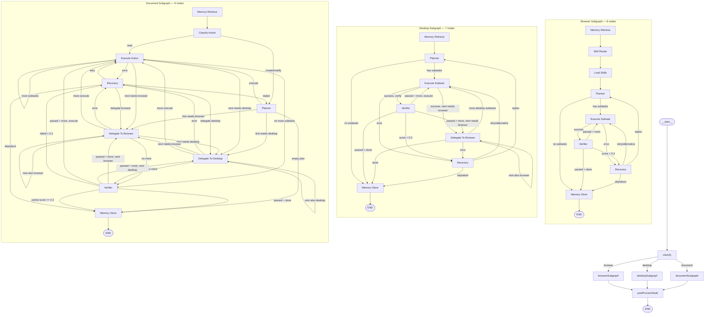

# Overall Architecture

> Auto-maintained by Cursor agent. See `.cursor/rules/doc-sync-on-changes.mdc` for sync rules.
> Last updated: 2026-05-12

## Current Architecture

**Stack**: Electron 42 + React 19 + TypeScript 6.0 + Vite 8, Windows-first with sandboxed renderer.

**Main Process**: Single Electron app entry (`src/main/main.ts`) that initializes dotenv, registers IPC handlers, global shortcuts (Alt+Space), system tray, and pre-compiles the LangGraph ask graph on startup. Security: `app.enableSandbox()`, navigation blocked to external URLs, window creation denied, menu bar hidden.

**Renderer**: React SPA (`src/renderer/App.tsx`) with CommandPalette, file search (Everything on Windows), and AI mode with LangGraph streaming.

**IPC Layer**: Main handlers in `src/main/ipc/handlers.ts` + API config in `src/main/ipc/api-config.ts` + browser handlers in `src/main/ipc/browser-handlers.ts`. Renderer communicates via Electron IPC channels.

**LangGraph Agent**: Hierarchical architecture with one main AskGraph (5 nodes) routing through 3 smart subgraphs:

- **AskGraph** (`src/main/services/langgraph/research-agent.ts`): Simplified StateGraph with `classify` node routing to 3 subgraphs only (`browserSubgraph`, `desktopSubgraph`, `documentSubgraph`) → `postProcessNode` → END. `browserSubgraphNode` is a smart wrapper that handles fast-path, comparison, form, chart, external search, internal knowledge, and general chat inline before delegating to `executeBrowserSubgraph` for actual browser intent. `desktopSubgraphNode` and `documentSubgraphNode` check intent and fall back to inline LLM if not their domain. `postProcessNode` detects markdown tables and extracts comparison/form/chart patterns from all subgraph outputs into UIPayloads. Models: `qwen3.6-plus` for all roles (chatModel temp 0.7, routerModel temp 0, rewriteModel temp 0).

- **BrowserSubgraph** (`src/main/services/browser/browser-subgraph.ts`, 8 nodes): Memory -> skillRouter -> loadSkills -> planner -> executeSubtask <-> verifier loop. 5 recovery strategies (retry, alternative, replan, skip, abort). Skill catalog: web-navigation, form-filling, data-extraction, web-scraping, authentication, visual-interaction.

- **DesktopSubgraph** (`src/main/services/desktop/desktop-subgraph.ts`, 7 nodes): Memory -> planner -> executeSubtask <-> verifier loop with `delegateToBrowser` for cross-agent delegation. Verifier uses UIA accessibility tree + screenshot fallback. Conditional routers check `requiresBrowser` flag on next subtask.

- **DocumentSubgraph** (`src/main/services/document/document-subgraph.ts`, 9 nodes): Memory -> classifyAction (read/create/modify) -> planner/executeAction. Dual cross-agent delegation via `delegateToBrowser` and `delegateToDesktop`. Supports docx, xlsx, pptx, pdf formats.

## LangGraph Topology Diagram

**MCP Services**: `src/main/services/mcp/client.ts` — MultiServerMCPClient for external MCP server integration, cleaned up on `will-quit`.

**Browser Automation**: `src/main/services/browser/stateful-browser-agent.ts` — Playwright-based agent with session manager (`browser-session-manager.ts`). Chromium installed via `npx playwright install chromium` at startup.

**Desktop Automation**: `src/main/services/desktop/` — Windows-only ReAct loop with 28 LangChain tools, Win32 FFI (koffi), PowerShell UIA accessibility tree, Electron desktopCapturer screenshots, pixel-diff verifier. Supports cross-agent browser delegation for hybrid desktop+web tasks.

**Database**: better-sqlite3 via `src/main/services/database/database-manager.ts` — stores desktop agent trajectories and failure memories for experience-based retrieval, including cross-agent delegation metadata.

## Changelog

<!-- New entries added at the top (newest first) -->

### [2026-05-13] simplify-ask-graph: Collapse AskGraph from 16 nodes to 5 nodes with 3-target routing
- **What**: Restructured the AskGraph so `classify` routes to only 3 targets: `browserSubgraph`, `desktopSubgraph`, `documentSubgraph`. All other logic (fast-path, comparison, form, chart, external search, internal knowledge, general chat) absorbed into `browserSubgraphNode` as inline handlers. Added `postProcessNode` as unified markdown table detector and UI payload extractor after all subgraphs. Removed 11 orphaned node functions: `fastPathNode`, `internalKnowledgeNode`, `externalSearchFanOutNode`, `synthesizeWithSelfCheckNode`, `quickVerifyNode`, `replanNode`, `fallbackSearchNode`, `generalChatNode`, `comparisonNode`, `formNode`, `chartNode`, `desktopConfirmationNode`, plus 4 router functions (`routeAfterFanOut`, `routeAfterSynthesis`, `routeAfterQuickVerify`, `routeAfterInternalKnowledge`). Removed `verifierModel` (was only used by `quickVerifyNode`).
- **Files**: 
  - `src/main/services/langgraph/research-agent.ts` — collapsed graph to 5 nodes, `browserSubgraphNode` is now a smart wrapper with inline comparison/form/chart/external-search/internal-knowledge/general-chat handlers; `desktopSubgraphNode` and `documentSubgraphNode` check intent and fall back to inline LLM; `postProcessNode` detects tables + UI patterns
- **Impact**: Graph is much simpler to reason about (classify → subgraph → postProcessNode → END). All intent-specific logic runs inline within subgraph wrappers. Code reduced from ~1724 lines to ~1320 lines. No runtime behavior changes — same schemas, same models, same subgraph calls.
- **Details**: `routeAfterClassify` now returns only "browser"|"desktop"|"document". `browserSubgraphNode` uses keyword regex (comparison, form, chart) and intent/complexity checks to route internally. `postProcessNode` scans `finalResponse` for markdown tables and uses `chatModel.withStructuredOutput` to extract comparison/form/chart patterns from text. Graph compiles successfully with zero TypeScript errors.

### [2026-05-12] langgraph-topology-documentation: Document complete LangGraph topology with verified Mermaid diagram
- **What**: Verified the full LangGraph topology by reading all four graph source files and produced a corrected Mermaid diagram. The architecture consists of one main AskGraph (16 nodes) and three nested subgraphs: BrowserSubgraph (8 nodes), DesktopSubgraph (7 nodes), DocumentSubgraph (9 nodes). Key verified routing details:
  1. **AskGraph** — `classify` node routes to 10 branches (fast, internal, external, general, comparison, form, chart, browser, desktop, document). Research retry loop: `synthesizeWithSelfCheck` -> `replan` -> `externalSearchFanOut` (max 2 retries). Quality gate: `quickVerify` routes to END on pass (>=0.6) or `replan` on fail.
  2. **BrowserSubgraph** — Linear entry: `memoryRetrieve` -> `skillRouter` -> `loadSkills` -> `planner`. Execute/verify loop with 5 recovery strategies (retry, alternative, replan, skip, abort). Verifier routes to memoryStore on partial pass (score >= 0.3).
  3. **DesktopSubgraph** — Same memory->plan->execute pattern. Added `delegateToBrowser` node for cross-agent delegation. Conditional routers check `requiresBrowser` flag on next subtask to route between execute, delegate, verifier, recovery. `delegateToBrowser` has its own router: chains browser, routes to execute/memoryStore/recovery.
  4. **DocumentSubgraph** — Most complex with 9 nodes and dual delegation (`delegateToBrowser` + `delegateToDesktop`). `classifyAction` node classifies read/create/modify. Verifier routes to `memoryStore` on partial pass (score >= 0.3), not continue execution. `executeAction` routes to verifier only when no more subtasks remain.
- **Files**:
  - `overall-architecture.md` — added verified Mermaid diagram and topology details
- **Impact**: N/A — documentation only
- **Details**: Diagram verified against source code at: `src/main/services/langgraph/research-agent.ts` (lines 212-270 for graph construction), `src/main/services/browser/browser-subgraph.ts` (lines 470-509), `src/main/services/desktop/desktop-subgraph.ts` (lines 634-696), `src/main/services/document/document-subgraph.ts` (lines 594-665).

### [2026-05-12] cross-agent-delegation: Add browser delegation to desktop subgraph for hybrid tasks
- **What**: Enhanced the desktop agent workflow to detect browser-requiring subtasks and delegate them to the browser agent mid-execution. Added:
  1. **Cross-agent state fields** to AskState (`browserSessionId`, `delegateResults`, `crossAgentContext`) for typed handoff between agents
  2. **Browser detection** in desktop planner (`isBrowserTask()`) using regex patterns for URLs, web actions, and web task descriptions
  3. **DelegateToBrowser node** in desktop subgraph that invokes `executeBrowserSubgraph`, passes accumulated desktop context, receives structured results, and routes to next subtask
  4. **Verifier enhancement** with `verifyBrowserDelegation()` to validate browser delegation results before continuing desktop execution
  5. **Memory update** to store full cross-agent trajectories including delegated browser actions, agent type markers, and artifacts
- **Files**:
  - `src/main/services/langgraph/state.ts` — added `BrowserDelegationResult`, `CrossAgentContext` interfaces and 3 new state annotations
  - `src/main/services/desktop/types.ts` — added `requiresBrowser?: boolean` to Subtask interface
  - `src/main/services/desktop/desktop-planner.ts` — added `BROWSER_TASK_PATTERNS` and `isBrowserTask()` heuristic; `toSubtask()` and `fallbackPlan()` now flag browser tasks
  - `src/main/services/desktop/desktop-subgraph.ts` — added `delegateToBrowserNode`, state fields (`delegatedToBrowser`, `delegateResults`, `crossAgentContext`), conditional edges, router updates in `executeSubtaskRouter`, `verifierRouter`, and `delegateToBrowser` router; updated `memoryStoreNode` to include cross-agent metadata
  - `src/main/services/desktop/desktop-verifier.ts` — added `verifyBrowserDelegation()` method
- **Impact**: Complex multi-step tasks combining desktop and browser operations (e.g., "download CSV from web portal and import into Excel") can now be handled in a single user request without requiring separate desktop and browser queries
- **Details**: The desktop planner flags subtasks requiring web interaction. The `delegateToBrowser` node passes accumulated desktop context to the browser subgraph, receives structured results, and routes to the next subtask. Browser subtasks bypass the desktop verifier (browser subgraph has its own verifier). Recovery supports browser delegation failures. Cross-agent trajectories stored in memory include browser action counts, artifacts, and session IDs.

### [2026-05-12] fix-native-bindings: Fix Automation.node and sql.js loading errors in electron-vite dev/build
- **What**: Fixed two runtime errors in the desktop agent startup:
  1. `Automation.node` native bindings not found — `node-winautomation` is a native addon that electron-vite's bundler breaks by relocating JS to `out/main/`. Fixed by marking `node-winautomation` as external in rollup config and copying `Automation.node` to `out/main/` during post-build.
  2. `sql.js/package.json` not exported — `require.resolve('sql.js/package.json')` fails in ESM because `sql.js` doesn't export `./package.json`. Fixed by using `import.meta.resolve()` instead.
- **Files**:
  - `electron.vite.config.ts` — added `node-winautomation` to externals, added post-build copy of `Automation.node`, improved `__dirname` fallback
  - `src/main/services/database/database-manager.ts` — replaced `require.resolve('sql.js/package.json')` with `import.meta.resolve()`
- **Impact**: Desktop agent now starts without unhandled rejections; database initialization works; native UI Automation works in dev and build
- **Details**: The `bindings` library relies on `__dirname` to find `.node` files. Electron-vite replaces `import.meta.dirname` (Node 23+ only) with a broken fallback `"."`. Changed the fallback to derive `__dirname` from `__filename` via `path.dirname(__filename)` so `bindings` can walk up the tree correctly.

### [2026-05-12] initial-architecture: Document baseline system architecture
- **What**: Created initial architecture documentation covering main process, IPC, LangGraph, MCP, browser, and desktop agent layers.
- **Files**: 
  - `overall-architecture.md` — created with full architecture overview
- **Impact**: N/A — documentation only
- **Details**: Baseline covers Electron entry (`main.ts`), IPC handlers (`ipc/handlers.ts`, `ipc/api-config.ts`, `ipc/browser-handlers.ts`), LangGraph research agent (`langgraph/research-agent.ts`), MCP client (`mcp/client.ts`), Playwright browser agent (`browser/stateful-browser-agent.ts`), SQLite persistence (`database/database-manager.ts`), and desktop automation (`desktop/`). Security config: sandbox enabled, navigation restricted, window creation denied.
