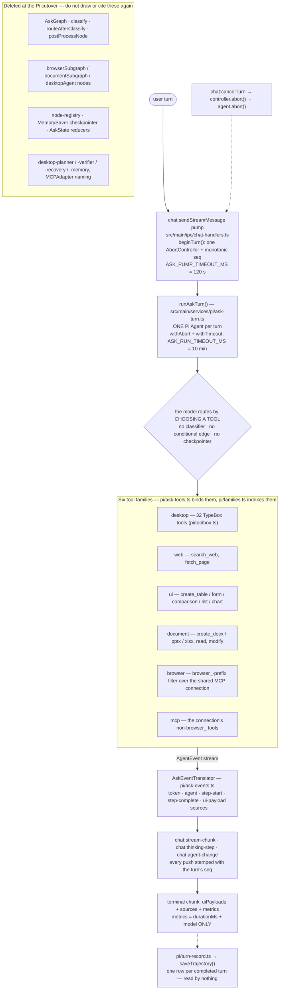

# Overall Architecture

> **Status**: live for "Current Architecture" and the diagram below, re-derived from this checkout on 2026-10-16; **history** for the "Changelog" section, whose entries describe the deleted LangGraph runtime. See `docs/AGENTS.md` rule 1.

## Current Architecture

**Stack**: Electron 42 + React 19 + TypeScript 6.0 + Vite 8, Windows-first with sandboxed renderer.

**Main Process**: single Electron app entry (`src/main/main.ts`) that loads dotenv and preferences, opens the sql.js database, initialises `es.exe` and the MCP client, registers the IPC handlers, the Alt+Space global hook and the system tray, then creates the palette window. Security: `app.enableSandbox()`, navigation blocked to external URLs, window creation denied, menu bar hidden. Nothing pre-compiles an agent graph at boot — there is no graph (`src/main/services/langgraph/` is deleted), and the Pi runtime that replaced it is constructed per Ask turn. What is genuinely deferred is *construction*: `getDesktopRuntime()` / `getDesktopToolbox()` and `getPiModels()` memoise, so the tesseract worker, the UIA facade and the provider are opened on first use rather than at startup. The MCP client is the opposite — it connects every configured server during `app.whenReady()` through `initializeWithRetry()`. Quit is a bounded, ordered teardown: `will-quit` calls `event.preventDefault()`, runs `buildShutdownSteps()` through `createShutdown()` (`src/main/lifecycle.ts`) and then `app.exit(0)`.

**Renderer**: two `electron-vite` MPA entries, not one SPA. The palette (`src/renderer/index.html` → `src/renderer/App.tsx`) holds CommandPalette, file search and Ask mode; the settings window (`src/renderer/settings.html` → `SettingsApp`) is a separate, lazily-created ordinary `BrowserWindow`. File search is Everything (`es.exe`) and indexes file and folder **names only** — there is no content search over file bodies. Ask mode streams over the `chat:stream-chunk` / `chat:agent-change` / `chat:thinking-step` pushes from the one Pi runtime.

**IPC Layer**: six handler modules — `src/main/ipc/handlers.ts` (25 channels), `chat-handlers.ts` (11), `mcp-handlers.ts` (10), `browser-handlers.ts` (9), `api-config.ts` (4) and `settings-handlers.ts` (3). Measured in this checkout: 62 unique `ipcMain.handle` channels and exactly one `ipcMain.on` receiver (`window:animationFrame`). The renderer reaches them only through `window.electronAPI` (`src/preload/preload.ts`). Per-channel contract lives in `src/main/ipc/AGENTS.md`.

**Ask agent runtime**: **one Pi `Agent` per turn.** There is no graph, no intent classifier, no conditional edges, no checkpointer and no delegation between agents — the model routes by choosing a tool. `runAskTurn()` (`src/main/services/pi/ask-turn.ts`) builds that agent over the six tool families assembled by `src/main/services/pi/ask-tools.ts` and indexed by `src/main/services/pi/families.ts`:

- **desktop** — 32 TypeBox `AgentTool`s in `src/main/services/pi/toolbox.ts`, the list frozen by name in `src/main/services/pi/toolbox.test.ts`. They drive the native substrate in `src/main/services/desktop/`.
- **web** — 2 tools (`search_web`, `fetch_page`) in `src/main/services/pi/tools/web-tools.ts`, over the `src/main/services/web/` search-and-fetch substrate.
- **ui** — 5 tools (`create_table`, `create_form`, `create_comparison`, `create_list`, `create_chart`) in `pi/tools/ui-tools.ts`; each returns a `details.uiPayload`.
- **document** — 5 tools (`create_docx`, `create_pptx`, `create_xlsx`, `read_document`, `modify_document`) in `pi/tools/document-tools.ts`, over the `src/main/services/document/` writers.
- **browser** — a `browser_`-prefix **filter** over the one shared MCP connection (`pi/tools/browser-tools.ts`), not a wrapper and not a second client.
- **mcp** — every other tool on that connection (`pi/tools/mcp-tools.ts`); an empty family is a valid state.

`buildFamilyIndex()` maps tool name → family → agent label and **throws** if two families claim the same name, because Pi resolves a call by name and a collision would make one family unreachable.

**`PiDesktopAgent` is not on the shipped path.** `src/main/services/pi/agent.ts` still exports `runPiDesktopTask()`, `getPiDesktopAgent()` and `abortPiDesktopRun()`, and nothing calls them: the only production imports of that file are `pi/ask-tools.ts` taking `getDesktopToolbox()` and `main.ts`'s `pi-desktop-agent` shutdown step taking `closePiDesktopAgent()`. The consequences are load-bearing for anyone reading the desktop docs — the initial-screenshot decision never runs, the `details.verifies` opt-in (set only by `close_window`) marks a check nothing consumes, and the pixel verifier's verdict is never fed back with `agent.steer()`. What remains in `src/main/services/desktop/verifier.ts` is a **change detector**, not a postcondition grader: `PIXEL_DIFF_THRESHOLD` 0.01, `ACTION_EFFECT_MIN_DIFF` 0.02 and a window-title signal. There is no weighted 0.4/0.4/0.2 scorer (that was `desktop-verifier.ts`, deleted) and no retry/alternative/replan/skip/abort ladder (that was `desktop-recovery.ts`, deleted). The browser subtree does still carry a recovery-strategy union as an inert type (`BrowserRecoveryAction` in `src/main/services/browser/types.ts`, `strategy: "retry" | "alternative" | "replan" | "skip" | "abort"`) with no code acting on it. Wiring the verifier into the Ask loop or deleting the unused half of `agent.ts` are both open decisions — do not describe either as current behaviour.

**Human-in-the-loop: none.** There is no approval gate and no `interrupt()`; `chat:resumeGraph` and `desktop:confirmation-request` were deleted along with `src/shared/ipc/hitl-decision.ts`, and no turn pauses or resumes. Every tool reports its own `details.status` — there is no `DANGER_POLICY` table and no toolbox-level `inferStatusFromTool` name map; both died with `desktop-agent.ts`. The one live `inferStatusFromTool` in the repo is unrelated: a private helper in `src/main/services/browser/stateful-browser-agent.ts` that turns a `browser_*` tool name into a `BrowserTaskProgress` status for the direct `browser:executeTask` path. `DangerLevel` (`desktop/types.ts`) is vestigial: re-exported by the barrel, consumed by nothing.

**Streaming**: `pi/ask-events.ts`'s `AskEventTranslator` turns each Pi `AgentEvent` into zero or more of the six `AskStreamEvent` kinds (`token`, `agent`, `step-start`, `step-complete`, `ui-payload`, `sources`). The pump in `src/main/ipc/chat-handlers.ts` emits them onto `chat:stream-chunk`, `chat:agent-change` and `chat:thinking-step`, every push stamped with a per-turn monotonic `seq` from `beginTurn()`. The terminal chunk carries `uiPayloads`, `sources` and `metrics`, and `metrics` is only `{durationMs, model}` — no token count and no cost, because the runtime reports neither. Step labels come from `FamilyIndex.displayLabelFor()`; `ThinkingStep` lives in `src/shared/ipc/thinking-step.ts` so the shape is declared once.

**Cancellation**: the pump owns one `AbortController` per turn (`activeTurns` in `chat-handlers.ts`) and `chat:cancelTurn` aborts it. `runAskTurn` attaches `abort → agent.abort()` and wraps the prompt in `withAbort(withTimeout(…, ASK_RUN_TIMEOUT_MS = 10 min), signal)`. The pump's own leash is separate and much shorter — `ASK_PUMP_TIMEOUT_MS` = 120 s — and bounds *waiting*, not the model run.

## Ask Runtime Diagram

The canonical, fully evidenced version of this diagram is `docs/diagrams/ask-routing.mmd` (with its rendered `.svg`); the block below is the same shape, kept short so the two cannot drift far.

**MCP Services**: `src/main/services/mcp/client.ts` — the `MCPService` client (the name `MCPAdapter` in this file and in `CHANGELOG.md` is the pre-cutover name for the same object) connects every server declared in `mcp-config.json` plus preferences, converts each server's JSON Schema tools into Pi tools once, and is released as the `mcp` step of the shutdown list in `src/main/main.ts` (bounded, ordered teardown before `app.exit(0)` — see `src/main/lifecycle.ts`). There is no MCP **server** in `src/`; the only one in the repo is `scripts/harness/mcp-server.mjs`. Every family filters this single connection rather than opening its own.

**Browser Automation**: the browser capability is a Pi tool **family**, not a graph. `src/main/services/pi/tools/browser-tools.ts` filters the shared MCP connection by the `browser_` name prefix; `src/main/services/browser/stateful-browser-agent.ts` is a Pi `Agent` over that same toolbox for the direct `browser:executeTask` IPC path, with `browser-session-manager.ts` keeping one session and auto-closing it after 5 min inactivity. There is no planner, verifier or recovery ladder in this subtree — the model plans. Chromium is installed via `npx playwright install chromium` during startup. The `SKILL.md` prompt material under `browser/skills/` is read from disk and is **not** copied into a production build, so skills are only observable under `npm run dev`.

**Desktop Automation**: the tools are `src/main/services/pi/toolbox.ts` (32 TypeBox `AgentTool`s, frozen by name in `pi/toolbox.test.ts`) and the native substrate they drive is `src/main/services/desktop/` — Win32 FFI through koffi and libwin32 (`input-simulation.ts`), UI Automation through native `node-winautomation` COM (`uia-native.ts`, facade `accessibility-tree.ts`; the PowerShell UIA wrapper was dead and is deleted), Electron `desktopCapturer` screenshots, tesseract OCR, and the `verifier.ts` change detector described above. There is no desktop subgraph, no planner, no recovery ladder and no cross-agent browser delegation: the single Ask agent holds the desktop, browser and document tools at once, so a "delegation" is just the model calling a `browser_` tool mid-turn.

**Database**: `sql.js` via `src/main/services/database/database-manager.ts`, persisted to `app.getPath('userData')/desktop-agent.db` (`persistToDisk` writes the whole file on every write; there is no WAL). Four migrations create four tables — `desktop_trajectories`, `desktop_trajectory_steps`, `desktop_failures` and `migrations`. **The tables are written and never read back**: the Ask pump is the only production writer (`pi/turn-record.ts` builds one `TrajectoryRecord` per completed turn and `chat-handlers.ts` calls `saveTrajectory()`), `recordFailure()` has zero callers, and no code feeds a trajectory into a prompt. There is no `browser-memory`/`trajectories.db` store any more and no cross-agent delegation metadata to record. (`better-sqlite3` is not in `package.json`; it was declared, imported by nothing, and removed.)

## Changelog

Entries below are dated history: a record of what changed, never of what exists. Every
`src/main/services/langgraph/*`, `desktop/desktop-*` and `document/document-subgraph.ts` path they
name — and the `:line` citations attached to them — was deleted at the Pi cutover, so none of those
files or symbols resolve in this checkout. Do not cite an entry as current behaviour.

<!-- New entries added at the top (newest first) -->

### [2026-05-13] simplify-ask-graph: Collapse AskGraph from 16 nodes to 5 nodes with 3-target routing
- **What**: Restructured the AskGraph so `classify` routes to only 3 targets: `browserSubgraph`, `desktopSubgraph`, `documentSubgraph`. All other logic (fast-path, comparison, form, chart, external search, internal knowledge, general chat) absorbed into `browserSubgraphNode` as inline handlers. Added `postProcessNode` as unified markdown table detector and UI payload extractor after all subgraphs. Removed 11 orphaned node functions: `fastPathNode`, `internalKnowledgeNode`, `externalSearchFanOutNode`, `synthesizeWithSelfCheckNode`, `quickVerifyNode`, `replanNode`, `fallbackSearchNode`, `generalChatNode`, `comparisonNode`, `formNode`, `chartNode`, `desktopConfirmationNode`, plus 4 router functions (`routeAfterFanOut`, `routeAfterSynthesis`, `routeAfterQuickVerify`, `routeAfterInternalKnowledge`). Removed `verifierModel` (was only used by `quickVerifyNode`).
- **Files**: 
  - `src/main/services/langgraph/research-agent.ts` — collapsed graph to 5 nodes, `browserSubgraphNode` is now a smart wrapper with inline comparison/form/chart/external-search/internal-knowledge/general-chat handlers; `desktopSubgraphNode` and `documentSubgraphNode` check intent and fall back to inline LLM; `postProcessNode` detects tables + UI patterns
- **Impact**: Graph is much simpler to reason about (classify → subgraph → postProcessNode → END). All intent-specific logic runs inline within subgraph wrappers. Code reduced from ~1724 lines to ~1320 lines. No runtime behavior changes — same schemas, same models, same subgraph calls.
- **Details**: `routeAfterClassify` now returns only "browser"|"desktop"|"document". `browserSubgraphNode` uses keyword regex (comparison, form, chart) and intent/complexity checks to route internally. `postProcessNode` scans `finalResponse` for markdown tables and uses `chatModel.withStructuredOutput` to extract comparison/form/chart patterns from text. Graph compiles successfully with zero TypeScript errors.

### [2026-05-12] langgraph-topology-documentation: Document complete LangGraph topology with verified Mermaid diagram
- **What**: Verified the full LangGraph topology by reading all four graph source files and produced a corrected Mermaid diagram. The architecture consists of one main AskGraph (16 nodes) and three nested subgraphs: BrowserSubgraph (8 nodes), DesktopSubgraph (7 nodes), DocumentSubgraph (9 nodes). Key verified routing details:
  1. **AskGraph** — `classify` node routes to 10 branches (fast, internal, external, general, comparison, form, chart, browser, desktop, document). Research retry loop: `synthesizeWithSelfCheck` -> `replan` -> `externalSearchFanOut` (max 2 retries). Quality gate: `quickVerify` routes to END on pass (>=0.6) or `replan` on fail.
  2. **BrowserSubgraph** — Linear entry: `memoryRetrieve` -> `skillRouter` -> `loadSkills` -> `planner`. Execute/verify loop with 5 recovery strategies (retry, alternative, replan, skip, abort). Verifier routes to memoryStore on partial pass (score >= 0.3).
  3. **DesktopSubgraph** — Same memory->plan->execute pattern. Added `delegateToBrowser` node for cross-agent delegation. Conditional routers check `requiresBrowser` flag on next subtask to route between execute, delegate, verifier, recovery. `delegateToBrowser` has its own router: chains browser, routes to execute/memoryStore/recovery.
  4. **DocumentSubgraph** — Most complex with 9 nodes and dual delegation (`delegateToBrowser` + `delegateToDesktop`). `classifyAction` node classifies read/create/modify. Verifier routes to `memoryStore` on partial pass (score >= 0.3), not continue execution. `executeAction` routes to verifier only when no more subtasks remain.
- **Files**:
  - `overall-architecture.md` — added verified Mermaid diagram and topology details
- **Impact**: N/A — documentation only
- **Details**: Diagram verified against source code at: `src/main/services/langgraph/research-agent.ts` (lines 212-270 for graph construction), `src/main/services/browser/browser-subgraph.ts` (lines 470-509), `src/main/services/desktop/desktop-subgraph.ts` (lines 634-696), `src/main/services/document/document-subgraph.ts` (lines 594-665).

### [2026-05-12] cross-agent-delegation: Add browser delegation to desktop subgraph for hybrid tasks
- **What**: Enhanced the desktop agent workflow to detect browser-requiring subtasks and delegate them to the browser agent mid-execution. Added:
  1. **Cross-agent state fields** to AskState (`browserSessionId`, `delegateResults`, `crossAgentContext`) for typed handoff between agents
  2. **Browser detection** in desktop planner (`isBrowserTask()`) using regex patterns for URLs, web actions, and web task descriptions
  3. **DelegateToBrowser node** in desktop subgraph that invokes `executeBrowserSubgraph`, passes accumulated desktop context, receives structured results, and routes to next subtask
  4. **Verifier enhancement** with `verifyBrowserDelegation()` to validate browser delegation results before continuing desktop execution
  5. **Memory update** to store full cross-agent trajectories including delegated browser actions, agent type markers, and artifacts
- **Files**:
  - `src/main/services/langgraph/state.ts` — added `BrowserDelegationResult`, `CrossAgentContext` interfaces and 3 new state annotations
  - `src/main/services/desktop/types.ts` — added `requiresBrowser?: boolean` to Subtask interface
  - `src/main/services/desktop/desktop-planner.ts` — added `BROWSER_TASK_PATTERNS` and `isBrowserTask()` heuristic; `toSubtask()` and `fallbackPlan()` now flag browser tasks
  - `src/main/services/desktop/desktop-subgraph.ts` — added `delegateToBrowserNode`, state fields (`delegatedToBrowser`, `delegateResults`, `crossAgentContext`), conditional edges, router updates in `executeSubtaskRouter`, `verifierRouter`, and `delegateToBrowser` router; updated `memoryStoreNode` to include cross-agent metadata
  - `src/main/services/desktop/desktop-verifier.ts` — added `verifyBrowserDelegation()` method
- **Impact**: Complex multi-step tasks combining desktop and browser operations (e.g., "download CSV from web portal and import into Excel") can now be handled in a single user request without requiring separate desktop and browser queries
- **Details**: The desktop planner flags subtasks requiring web interaction. The `delegateToBrowser` node passes accumulated desktop context to the browser subgraph, receives structured results, and routes to the next subtask. Browser subtasks bypass the desktop verifier (browser subgraph has its own verifier). Recovery supports browser delegation failures. Cross-agent trajectories stored in memory include browser action counts, artifacts, and session IDs.

### [2026-05-12] fix-native-bindings: Fix Automation.node and sql.js loading errors in electron-vite dev/build
- **What**: Fixed two runtime errors in the desktop agent startup:
  1. `Automation.node` native bindings not found — `node-winautomation` is a native addon that electron-vite's bundler breaks by relocating JS to `out/main/`. Fixed by marking `node-winautomation` as external in rollup config and copying `Automation.node` to `out/main/` during post-build.
  2. `sql.js/package.json` not exported — `require.resolve('sql.js/package.json')` fails in ESM because `sql.js` doesn't export `./package.json`. Fixed by using `import.meta.resolve()` instead.
- **Files**:
  - `electron.vite.config.ts` — added `node-winautomation` to externals, added post-build copy of `Automation.node`, improved `__dirname` fallback
  - `src/main/services/database/database-manager.ts` — replaced `require.resolve('sql.js/package.json')` with `import.meta.resolve()`
- **Impact**: Desktop agent now starts without unhandled rejections; database initialization works; native UI Automation works in dev and build
- **Details**: The `bindings` library relies on `__dirname` to find `.node` files. Electron-vite replaces `import.meta.dirname` (Node 23+ only) with a broken fallback `"."`. Changed the fallback to derive `__dirname` from `__filename` via `path.dirname(__filename)` so `bindings` can walk up the tree correctly.

### [2026-05-12] initial-architecture: Document baseline system architecture
- **What**: Created initial architecture documentation covering main process, IPC, LangGraph, MCP, browser, and desktop agent layers.
- **Files**: 
  - `overall-architecture.md` — created with full architecture overview
- **Impact**: N/A — documentation only
- **Details**: Baseline covers Electron entry (`main.ts`), IPC handlers (`ipc/handlers.ts`, `ipc/api-config.ts`, `ipc/browser-handlers.ts`), LangGraph research agent (`langgraph/research-agent.ts`), MCP client (`mcp/client.ts`), Playwright browser agent (`browser/stateful-browser-agent.ts`), SQLite persistence (`database/database-manager.ts`), and desktop automation (`desktop/`). Security config: sandbox enabled, navigation restricted, window creation denied.
